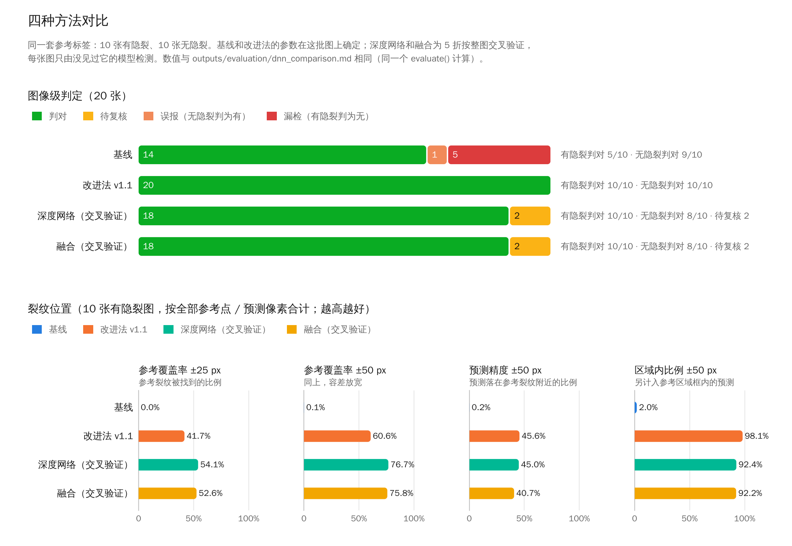
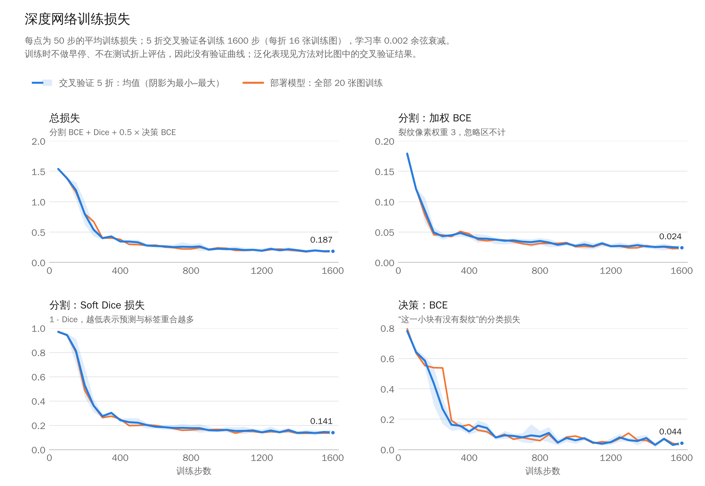
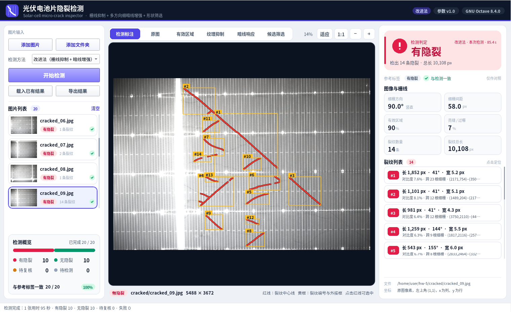
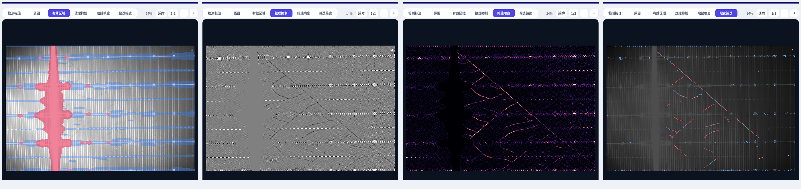

# 太阳能电池片隐裂检测（MATLAB）

数字图像处理大作业：对太阳能电池片实拍图像逐张判断是否存在**可见内部隐裂**，并在原图上标出裂纹位置与坐标边界框。
方法为传统图像处理（不训练模型）：有效区域与背景估计 → 栅线方向/间距估计与双向纹理抑制 →
多方向细暗线增强与长程方向一致性桥接 → 双阈值、骨架化、测地切线多轮共线/T 型连接与双准则筛选 →
联合延伸生长 → 映射回原图并沿法向吸附到暗线中心。

完整的设计说明见 [`docs/设计报告.md`](docs/设计报告.md)。

## 下载与运行（第一次使用请看这里）

程序在你自己的电脑上本地运行，不需要联网。

**1. 下载**

- 下载压缩包：<https://github.com/kongfanye/hw-5/archive/refs/heads/claude/vibrant-cray-19kkdm.zip>（约 100 MB，包含 20 张原图和全部实测结果）
- 或者打开分支页面 <https://github.com/kongfanye/hw-5/tree/claude/vibrant-cray-19kkdm>，点绿色的 **Code → Download ZIP**
- 解压到任意文件夹即可，路径中可以有中文和空格

**2. 准备软件（二选一）**

| 软件 | 说明 |
| --- | --- |
| MATLAB（推荐 R2020a 及以上）+ Image Processing Toolbox | 课程要求的环境。R2016b–R2019b 也能运行，但中文 Windows 上界面中文可能显示为乱码 |
| GNU Octave 7 及以上（免费） | Windows 安装包自带 image 包；macOS 用 `brew install octave`；Linux 安装 `octave` 和 `octave-image`。缺少 image 包时程序会提示在 Octave 中运行 `pkg install -forge image` |

**3. 启动图形界面**

- Windows：双击文件夹里的 `start_app.bat`
- macOS / Linux：在终端运行 `bash start_app.sh`
- 也可以手动启动：打开 MATLAB，把“当前文件夹”切换到解压出来的文件夹，在命令窗口输入 `crack_app`

启动脚本会先找 MATLAB，找不到再找 GNU Octave。缺少工具箱或 image 包时，程序会用中文说明缺什么、怎么安装。

**4. 试用**

- 点界面中间的 **“一键载入示例”**：几十秒内就能看到 20 张示例图的判定和裂纹位置（读取 `outputs/` 中已有的检测结果）
- 想看程序现场检测：选中一张图按 **R**；或者点 **“添加图片 / 添加文件夹”** 加入你自己的有隐裂、无隐裂图片，再点 **“开始检测”**（每张约 10–90 秒，取决于电脑速度）
- 批量检测并写出全部结果：在 MATLAB 命令窗口输入 `run_demo`

## 运行环境

| 项目 | 说明 |
| --- | --- |
| MATLAB | 需要 MATLAB R2016b 及以上 + Image Processing Toolbox（本地桌面端支持图形化选图与双栏联动缩放查看器） |
| GNU Octave | 兼容 GNU Octave 8+ 与 `image` 包（无图形界面时自动以命令行批处理模式运行） |
| 不依赖 | Statistics Toolbox、Computer Vision Toolbox（百分位数、稳健统计、点阵字体绘制、JSON 写出均在 `src/` 中自行实现） |

用到的工具箱基础函数：`hough / houghpeaks / houghlines / imdilate / imreconstruct / bwmorph / bwlabel / bwareaopen / bwdist / regionprops / padarray / im2double / im2uint8 / ind2rgb`。

## 助教现场验收（全新图像测试，推荐入口）

验收时面对助教给出的全新太阳能电池片图像（任意分辨率、任意细栅方向、单张或混合文件夹），直接在 MATLAB 命令窗口运行：

```matlab
run_inspect
```

1. **零参数图形化导入**：不带参数运行 `run_inspect` 会弹出选择框，可直接点选**整个测试文件夹**（自动递归扫描子目录）或**单张/多张图片**；
2. **命令行直接传路径**（支持文件夹、单张图片或混合元胞数组，路径可含中文和空格）：
   ```matlab
   run_inspect('D:\助教测试样本')
   run_inspect('D:\助教测试样本\test_01.jpg')
   run_inspect({'D:\图1.jpg', 'D:\图2.bmp'})
   ```
3. **直观输出**：
   - 命令窗口直接打印**逐张判定结果（有缺陷 / 无缺陷 / 待复核）、检出裂纹条数与每条裂纹的像素边界框 `[x_min, y_min, x_max, y_max]`**；
   - 自动弹出**交互式双栏联动查看器**（左栏原图、右栏红线+黄框标注图，使用工具栏放大镜放大右侧裂纹时，左侧原图**同步放大到同一像素区域**以便核对原始暗纹；支持键盘 `←`/`→` 翻页及一键筛选有缺陷样本）；
   - 结果独立保存在 `outputs/inspect/`（含 `overlays/*.jpg`、`masks/*.png`、`results.csv`、`defects.json`），**不会覆盖** `outputs/` 中原有的实验基准结果。
4. **加上深度网络**（需先安装 Python 依赖，见下文“深度网络”一节）：`run_inspect('D:\助教测试样本', 'DNN', true)`，
   在传统方法之后再运行网络并融合，汇总表和查看器显示融合结果（`outputs/inspect/fusion/`），网络补充的裂纹为品红色。

## 完整实验复现（改进法 + 基线对照 + 定量评估）

在项目目录的 MATLAB 命令窗口：

```matlab
run_demo
```

或在终端（项目目录下）：

```bash
matlab -batch "run_demo"
```

`run_demo` 会对仓库样本依次运行改进法与基线法，写出 `outputs/`（改进法）、`outputs/baseline/`（基线）、`outputs/evaluation/`（图像级与位置级评估），完整控制台记录保存在 `outputs/run_demo_log.txt`。

更多批处理与单图调用示例：

```matlab
run_batch({'D:\电池片样本'}, 'D:\检测结果')                          % 只跑改进法批处理
run_batch('cracked/cracked_06.jpg', 'outputs/single_test')          % 单张图像导出
run_batch('data/raw', 'outputs_base', 'Method', 'baseline')         % 只跑基线
run_batch('data/raw', 'out', 'Debug', {'*'})                        % 输出 7 步中间结果拼图

% 纯函数调用（只接收像素矩阵和参数结构体，不读取文件名、目录名或标签）
addpath('src');
G   = read_gray('cracked/cracked_06.jpg');
cfg = crack_config();
res = detect_cracks(G, cfg);
res.status, res.nCracks, res.cracks(1).bbox
```

## 深度网络（Python + TensorFlow）与融合

借鉴参考工程 [Segmentation-Based Silicon Solar Panel Defect Detection](https://github.com/dreaming-zh/Segmentation-Based-Silicon-Solar-Panel-Defect-Detection)
（Tabernik 等 2019 的“分割网络 + 决策网络”），本项目新增了一个深度网络，并与传统方法（改进法）融合。
网络部分用 Python + TensorFlow 实现，传统方法与图形界面仍是 MATLAB；两边的结果格式相同，可互相读取。

**安装（一次）**：Python 3.9–3.12，然后

```bash
pip install -r dnn/requirements.txt
```

**使用**：

| 方式 | 命令 | 说明 |
| --- | --- | --- |
| MATLAB 一条命令 | `run_dnn('D:\新图片')` | 依次运行传统方法、深度网络并融合，结果写到 `outputs/dnn_inspect/{traditional,dnn,fusion}` |
| 图形界面 | `crack_app` → 检测方法选“深度网络（单独）”或“改进法 + 深度网络融合” → 开始检测 | 网络检出 / 补充的裂纹用品红色画出；新增“网络概率”视图 |
| 纯 Python | `python dnn/predict.py D:/新图片 --out outputs/dnn` | 加 `--fuse outputs/inspect` 可与已有的传统方法结果融合 |

MATLAB 按 `'Python'` 参数 → 环境变量 `DNN_PYTHON` → `python3` → `python` → `py -3` 的顺序查找装好依赖的 Python。

**它是怎么做的**（详见设计报告第 8 章）：

1. **标签**：参考工程靠人工逐像素涂掩膜。本项目用 `tools/make_dnn_labels.m` 半自动生成：传统方法检出的裂纹 ∪ 人工参考折线“吸附”到真实暗线脊；吸附失败的走廊、裂纹两侧过渡带、区域框内未标注的强暗线设为“忽略”（不计损失）。结果在 `data/dnn_labels/`，`preview/` 里可直接查看。
2. **输入**：先用频谱估计细栅间距（与 MATLAB 的估计相差 ≤ 2%），把图像缩放到统一栅距 28 px；输入两通道：灰度、亮度校正残差 (I−B)/B（作用同参考工程的同态滤波）。
3. **网络**：4 级 U-Net 编码器–解码器输出逐像素裂纹概率；决策分支对最深层特征和概率图做全局最大 / 平均池化，输出“本块有无裂纹”。约 0.53 M 参数，权重 2 MB。
4. **训练**：随机裁取 256×256 小块，约一半以裂纹为中心；旋转（含 90° 与 ±12°）、翻转、±15% 尺度、亮度和噪声增强；损失 = 加权 BCE + Dice（忽略区不计）+ 0.5 × 决策 BCE。
5. **判定**：概率图双阈值（0.6 / 0.35）→ 骨架化 → 长度 ≥ 3 个栅距的段为裂纹；只有较短的可疑段时为“待复核”。
6. **融合**：传统方法裂纹 ∪ 网络裂纹中离传统裂纹超过 1 个栅距、连续长度 ≥ 1.5 个栅距的段（品红色）；任一方法判为有隐裂即为有隐裂。
7. **评估**：按整张图做 5 折交叉验证（每折 2 张有隐裂 + 2 张无隐裂不参与训练），每张图只由没见过它的模型检测，避免参考工程那样的数据泄漏。

**交叉验证结果**（`outputs/dnn_cv/`、`outputs/fusion_cv/`，对比表见 `outputs/evaluation/dnn_comparison.md`）：

| 方法 | 有隐裂判对 | 无隐裂判对 | 待复核 | 误报 / 漏检 | 覆盖率@25 | 覆盖率@50 | 预测精度@50 | 区域内比例@50 |
| --- | --- | --- | --- | --- | --- | --- | --- | --- |
| 基线 | 5 / 10 | 9 / 10 | 0 | 1 / 5 | 0.0% | 0.1% | 0.2% | 2.0% |
| 改进法 v1.1（传统） | 10 / 10 | 10 / 10 | 0 | 0 / 0 | 41.7% | 60.6% | 45.6% | 98.1% |
| **深度网络** | 10 / 10 | 8 / 10 | 2 | 0 / 0 | **54.1%** | **76.7%** | 45.0% | 92.4% |
| 融合 | 10 / 10 | 8 / 10 | 2 | 0 / 0 | 52.6% | 75.8% | 40.7% | 92.2% |

- 网络的裂纹位置覆盖率比传统方法高约 16 个百分点（10 张有隐裂图中 9 张更高、1 张持平），预测精度不变：多找到的主要是参考折线上的真实裂纹，网络画出的裂纹也更连贯（传统方法在亮细栅处常断成几段）。
- 网络没有把无隐裂图判成有隐裂，但 uncracked_04、uncracked_10 各有 1 条接近阈值的短候选，判为“待复核”。
- 融合的覆盖率与网络相当，预测精度略低（传统方法的一部分误检被带了进来）；它的价值在于两种方法互为备份、传统方法的结果可解释，而不是更准。
- 只有 20 张同一批次的图，每折测试 4 张，指标波动较大；换相机、换组件型号后的表现还没有样本验证。图形界面和 `run_inspect` 默认仍用改进法（不依赖 Python）。



训练损失（5 折各 1600 步，阴影为 5 折的最小–最大范围）：各折曲线几乎重合，约 300 步后进入平缓下降，部署模型落在各折范围内。
训练时不在测试折上评估、不做早停，所以没有验证曲线，泛化表现以上面的交叉验证结果为准。



**复现**：`python dnn/cv.py --final`（5 折交叉验证 + 用全部 20 张图训练部署模型，CPU 约 2 小时）；
`python dnn/evaluate.py outputs outputs/baseline outputs/dnn_cv outputs/fusion_cv` 输出对比表；
`python dnn/plot_figures.py` 重画上面两张图（读 `dnn/models/` 的训练记录，用同一个 `evaluate()` 复算指标）。
部署模型 `dnn/models/crack_dnn.weights.h5` 用全部 20 张图训练；`--final` 还会把它在训练图上的结果写到 `outputs/dnn/`、`outputs/fusion/`（只供查看，不能当作评估，未提交到仓库）。
在图形界面里点“载入已有结果”选 `outputs/dnn_cv` 或 `outputs/fusion_cv`，可直接查看交叉验证的检测结果。

## 图形界面小程序（`crack_app`）



在项目目录的 MATLAB 命令窗口输入：

```matlab
crack_app            % 打开界面，用左侧按钮添加图片或文件夹，再点“开始检测”
crack_app('demo')    % 打开并直接载入项目中的 20 张示例图和 outputs/ 中已有的检测结果（不用等待检测）
```

GNU Octave：

```bash
octave --persist --eval "crack_app('demo')"
```

| 区域 | 显示的信息 |
| --- | --- |
| 左栏 | 添加图片 / 文件夹（扩展名大小写不敏感）、选择检测方法（改进法、基线、改进法 + 深度网络融合、深度网络单独；后两种需要 Python 环境）、开始 / 停止检测、载入已有结果（任意含 `defects.json` 的输出目录）、导出结果；带缩略图和状态标签的图片列表；检测概览（有隐裂 / 无隐裂 / 待复核 / 待检测的数量，以及与参考标签的一致率） |
| 中间 | 原尺寸图像查看器：滚轮缩放、拖动平移、双击适应窗口，放大后自动从原图裁取高清细节；六个视图：检测标注（红色中心线 + 编号外接框）、原图、有效区域、纹理抑制、暗线响应、候选筛选；底部显示当前视图的图例，状态栏实时显示鼠标处的原图坐标和灰度 |
| 右栏 | 判定卡片（有隐裂 / 无隐裂 / 待复核，裂纹数、总长、方法、用时）、参考标签对照、细栅方向与间距、有效区域和亮缝 / 过曝占比、复核原因、裂纹列表（长度、角度、宽度、对比度、跨越细栅数、原图坐标框），点击某条裂纹即放大定位并高亮 |

快捷键：↑ / ↓ 切换图片，1–6 切换视图，F 适应窗口，R 重新检测当前图片，Esc 取消选中裂纹。
在界面中检测的图片会生成全部中间视图；“载入已有结果”只恢复判定和裂纹位置（中间视图可按 R 重新检测生成）。
“导出结果”写出与 `run_batch` 相同格式的 `results.csv`、`defects.json`、原尺寸标注图和掩膜。



界面中的检测调用的就是 `detect_cracks` / `detect_baseline`，与批处理结果一致（如 cracked_09 在界面中检测同样得到 14 条裂纹）。
`data/labels.csv` 只用于显示“参考标签”和一致率，不参与检测。
界面由 `figure` + `uicontrol` + 坐标区绘图实现，不依赖 App Designer，MATLAB 与 Octave 共用同一份代码。
本次开发环境没有 MATLAB，界面在 GNU Octave 8.4 + Qt 下实际运行，用模拟的鼠标和键盘操作测试过各项交互，上面的截图即来自该环境；在 MATLAB 中的显示效果尚未实测。
`start_app.sh` 在 Linux + Octave 下测试过；`start_app.bat` 没有 Windows 环境可测，若双击无反应，请按上面的“手动启动”方式运行。

## 项目结构

```
start_app.bat / start_app.sh   双击（Windows）或 bash 运行（macOS/Linux）启动图形界面
crack_app.m             图形界面小程序：添加图片、检测、查看判定 / 位置 / 指标 / 中间结果、导出
run_inspect.m           助教现场验收专用入口：GUI 选图/文件夹 + 坐标汇总表 + 双栏联动查看器
run_dnn.m               在 MATLAB 中调用 Python 深度网络并与传统方法融合
run_demo.m              完整实验演示入口：改进法 + 基线 + 参考集定量评估
run_batch.m             扫描目录或文件、逐图检测并导出 CSV/JSON/标注图/掩膜/调试图
src/
  crack_config.m        全部参数定义（以实测细栅间距 pitch 为几何单位）
  check_requirements.m  检查 MATLAB 版本与工具箱（或 Octave 与 image 包），缺少时给出中文说明
  detect_cracks.m       改进法单图检测 = crack_response + segment_cracks
  crack_response.m      有效区/背景 → 亮度校正 → 栅线/横向结构抑制 → 暗线响应 → 方向一致性增强
  coherent_line_enhance.m 双侧长程方向一致性跨细栅桥接与淡裂纹增强
  segment_cracks.m      双阈值 → 骨架 → 断点连接 → 双准则筛选 → 联合延伸生长与次生淡裂纹回收
  link_segments.m       沿骨架测地切线估计 + 两轮共线断点连接 + T/X 型交点连接
  detect_baseline.m     基线：max(B-I,0) 稳健阈值 + 连通域面积/主轴长度筛选
  prepare_image.m       共用前端：栅线估计、自适应工作尺度、旋转对齐、亮缝/黑框排除、掩膜背景 B
  estimate_grid.m       Hough 线段长度加权方向 + 3×3 分块投影自相关求栅距
  dark_line_response.m  多方向两侧取样 min(左,右)-中心 细暗线响应
  skeleton_to_full.m    对齐坐标 → 原图坐标映射，原图沿法向吸附到暗线中心
  show_results_viewer.m MATLAB 桌面端双栏同步缩放结果浏览器
  make_overlay.m / save_debug.m / draw_text.m   醒目标注图、中间结果拼图、内置点阵字体
  debug_previews.m      把中间结果映射回原图方向，生成界面用的小尺寸预览
  fill_record.m 等      结果记录、results.csv、defects.json 写出（批处理与界面共用）
  evaluate_results.m    图像级与位置级评估（仅在评估阶段读取参考标签）
  disk_dilate.m 等      基于精确欧氏距离变换的快速圆盘形态学、抗混叠重采样、JSON/CSV 读写工具
tools/
  param_sensitivity.m   关键参数单因素敏感性实验
  robustness_test.m     新样本适应性检查：缩放、旋转、镜像、裁切、欠曝后重新检测（outputs/evaluation/robustness.md）
  make_dnn_labels.m     为深度网络生成半自动像素标签（data/dnn_labels/）
dnn/                    深度网络（Python + TensorFlow）
  model.py              分割网络 + 决策网络、损失函数
  train.py / cv.py      训练、按图像 5 折交叉验证、部署模型训练
  predict.py            检测新图像、与传统方法融合（输出格式同 run_batch）
  evaluate.py           与 MATLAB evaluate_results 同口径的评估
  plot_figures.py       画训练损失曲线和方法对比图（docs/images/）
  models/               部署模型与各折模型权重
data/
  labels.csv            参考类别与样本条件标签
  annotations.json      有隐裂样本的人工参考折线与区域框
  dnn_labels/           网络训练用的半自动像素标签（0 背景 / 255 裂纹 / 128 忽略）
cracked/ uncracked/     仓库原始样本图像（只读）
outputs/                实验输出（标注叠加图、二值掩膜、CSV/JSON、中间结果与评估报告）
docs/设计报告.md         课程设计报告
docs/images/            界面截图
```

## 关键参数（`src/crack_config.m`）

长度类参数以**细栅间距 `pitch`** 为单位，程序对每张图从像素自动估计栅距并换算，自适应不同分辨率与拍摄距离。

| 参数 | 默认值 | 单位 | 作用 |
| --- | --- | --- | --- |
| `targetPitchPx` / `maxWorkScale` | 28 / 1.6 | px / — | 工作图目标栅距及低分辨率图适度上采样上限 |
| `brightThresh` / `bigBrightArea` / `seamMargin` | 0.90 / 4 / 0.8 | 灰度 / pitch² / pitch | 亮缝、过曝区（及外圈黑框）判定与向外排除宽度 |
| `bgSigma` | 1.5 | pitch | 带掩膜高斯背景 `B` 的尺度 |
| `colBlock` / `rowBlock` / `rowBlockZ` | 2.5 / 4 / 10 | pitch | 沿细栅、主栅方向稳健抑制的分块尺度 |
| `structQuantile` | 0.7 | — | 对 `z` 沿两个方向求分位数并减去，压制重复结构残影 |
| `smoothLen` / `sideOffsets` | 1.0 / 0.08,0.13,0.20 | pitch | 单尺度暗线平滑长度与法向两侧取样偏移 |
| `cohHalfLen` / `cohBridgeGain` / `cohBoostGain` | 1.25 / 1.90 / 1.00 | pitch / — / — | 长程方向一致性跨细栅桥接半径与增益 |
| `zHigh` / `zLow` | 4.5 / 2.5 | z | 标准滞后阈值的峰值与生长下限 |
| `minLength` / `minCross` / `minMeanZ` | 3.0 / 2.0 / 3.0 | pitch / 根 / z | 标准裂纹最短长度、最少跨细栅数与平均响应下限 |
| `minFaintLen` / `minFaintCross` / `minFaintMeanZ` | 5.5 / 4.0 / 2.70 | pitch / 根 / z | 长程共线淡裂纹筛选下限 |
| `maxWidth` / `maxBusbarFrac` | 0.30 / 0.50 | pitch / — | 平均宽度上限（排除斑块）与汇流条带占比上限 |
| `linkGap` / `linkAngle` | 1.5 / 35 | pitch / ° | 近距离断点共线连接阈值 |
| `linkGapLong` / `linkAngleLong` | 3.5 / 15 | pitch / ° | 跨汇流条长距离共线连接阈值 |
| `growIter` / `growDist` / `growSeedZ` | 3 / 2.5 / 3.3 | 次 / pitch / z | 已确认有裂纹图像的联合延伸生长参数 |

## 输出与坐标规则

坐标统一使用**原图像素坐标**：左上角像素为 `(1,1)`，`x` 为列（向右），`y` 为行（向下）；
`bbox = [x_min, y_min, x_max, y_max]`（两端均包含在框内）；`points` 为中心线采样点 `[x, y]`，`endpoints` 为骨架端点。
