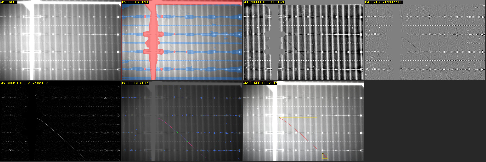
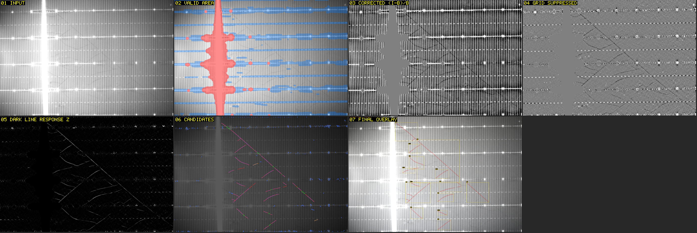
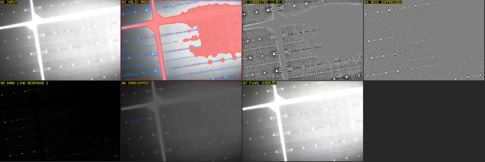
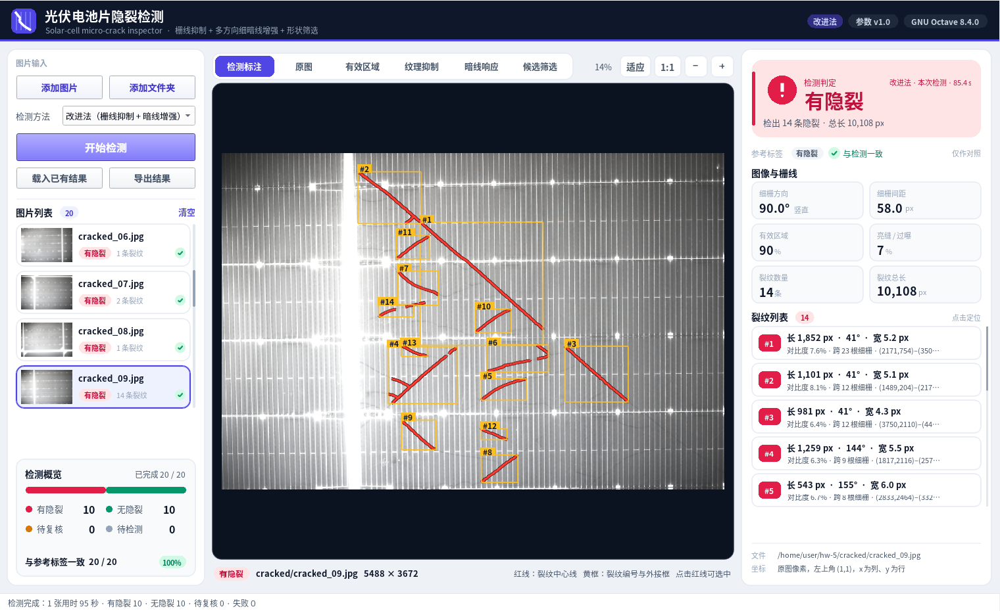
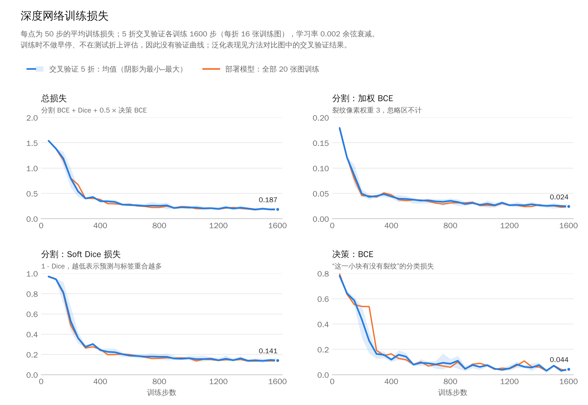
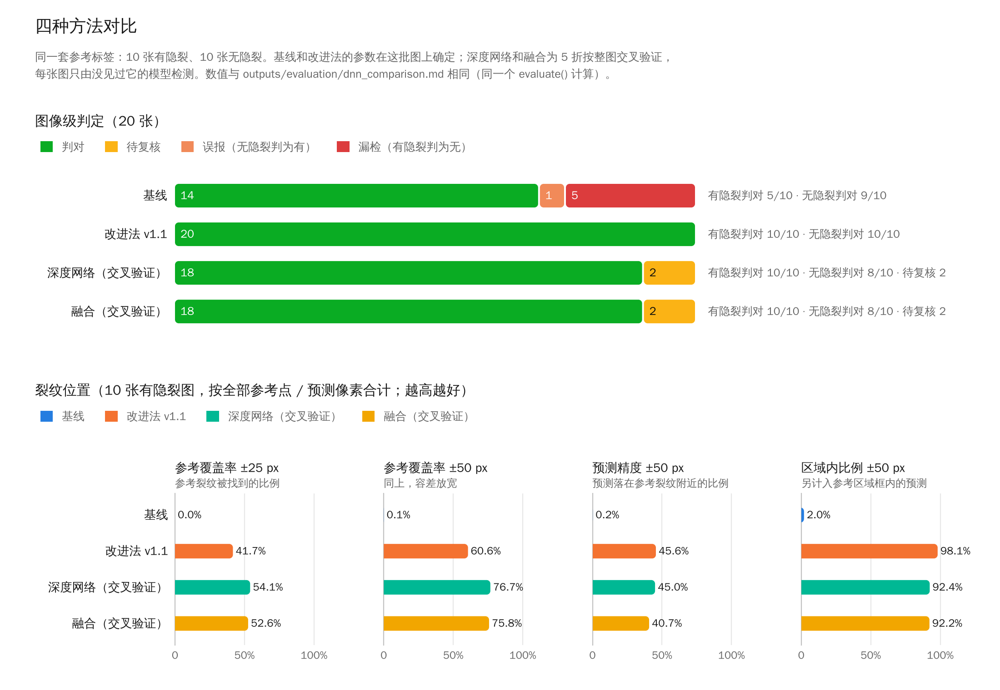
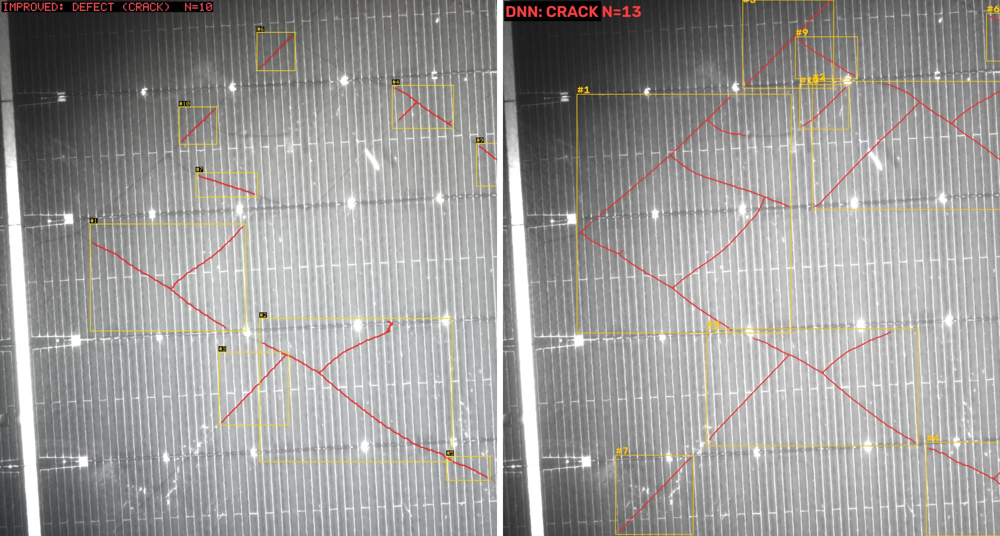

# 太阳能电池板内部缺陷（隐裂）检测 —— 设计报告

> 课程：数字图像处理 大作业　｜　实现语言：MATLAB（Image Processing Toolbox）；深度网络部分为 Python + TensorFlow　｜　难度系数 0.97

## 1 题目与检测目标

题目要求使用 10–20 张有缺陷样本和若干无缺陷样本，逐张判断电池片是否有缺陷，并标出缺陷位置。
结合题图与两批实拍图，本设计把**电池片内部的可见隐裂**作为检测目标：隐裂在图中表现为一条宽约 4–8 像素、
比两侧略暗（约暗 3%–10%）的细线，常斜向跨越大量细栅线，可以是单条长裂纹，也可以是相交、弯曲的网状裂纹。

需要排除的正常结构包括：等间距的亮细栅线及其边缘残影、细栅之间的点划状暗纹、交错排列的断栅短横线、
带焊点的汇流条及其两侧暗色焊带、电池片之间的亮缝和切角、大面积过曝区、孤立亮点/暗斑和亮色划痕。

主体方案（第 3–6 章）为**小样本可复现的传统图像处理**：不训练模型，所有阈值集中在 `src/crack_config.m`，
长度类参数以每张图实测的细栅间距（pitch）为单位，同一套参数处理全部图像。第 8 章另外借鉴参考工程训练了一个深度网络，
可以单独使用，也可以与传统方法融合。

**版本说明**：v1.0 为初版；v1.1 提高了淡裂纹的召回和断点连接的完整性，并增强了对新样本（黑边、低分辨率、旋转）的适应性。
第 3–4 章按 v1.1 描述，v1.1 新增或改动的内容标有“（v1.1）”；第 5 章分别列出两个版本调试中发现的问题；第 6 章的结果均为 v1.1，并与 v1.0 对比。

## 2 样本与参考标签

### 2.1 样本清点

| 项目 | 情况 |
| --- | --- |
| 原图数量与格式 | 20 张 JPG，均为 5488×3672，彩色（实际为灰度内容），JPEG 质量约 80 |
| 与题述 2048×1370 的关系 | 5488/2048 ≈ 3672/1370 ≈ 2.68，仓库中的图是原尺寸的 2.68 倍版本；题述“相邻细栅间距约 21–24 像素”对应本图约 56–64 像素。程序从像素估计栅距（本批实测 47.5–64.0 px），不依赖固定尺度 |
| 存放位置 | `cracked/cracked_01..10.jpg`（第一批）、`uncracked/uncracked_01..10.jpg`（第二批），保留原文件名，程序只读 |
| 题目截图 | `{3227C4FD-…}.png` 不在仓库中；扫描函数仍按 `{GUID}.png`、`preview`、`_overlay`、`_mask`、`outputs/` 等规则排除截图、预览图和程序输出 |

仓库中的文件已被重命名为序号，原始文件名中的拍摄时间不再可见，图像也没有 EXIF。
按“文件序号与任务表中时间顺序一致”推断对应关系，并用任务描述中的 4 个可见特征核对，全部吻合：

| 文件 | 推断时间 | 核对依据 |
| --- | --- | --- |
| cracked_01 | 20220726-083504 | 唯一一张细栅接近水平的图 |
| cracked_07 | 20220728-201710 | 亮缝右侧一条向右下、跨过多根细栅的长暗纹 |
| cracked_09 | 20220728-212250 | 亮缝右侧多条相交、弯曲的暗纹 |
| uncracked_07 | 20220906-202442 | 明显交叉亮缝和大面积高亮 |

`data/labels.csv` 记录每张图的文件名、推断时间、批次、标签、标签来源、复核状态、拍摄组和样本条件标签。
拍摄组按日期和时段划分：G1（0726 上午，1 张）、G2（0726 晚，2 张）、G3（0727 晚，3 张）、G4（0728 晚，3 张）、
G5（0905，1 张）、G6（0906，10 张无隐裂图，在约 2 分钟内连续拍摄）。

### 2.2 参考标注

- **类别标签**：第二批 10 张沿用提供的“无隐裂”标签，并目视浏览确认没有长暗纹；第一批 10 张逐张在原图和对比度拉伸视图上核实，**10 张都能看到明确的暗色裂纹**，不缺有隐裂样本。
- **位置标注**（`data/annotations.json`）：对第一批每张图画 1–5 条主要裂纹的参考折线（共 29 条）和一个包住全部可见裂纹的紧凑区域框。“放大核对”的折线在 0.4 倍以上局部视图描点，“概略”的折线在 0.27–0.33 倍总览图描点；用叠加检查估计**标注精度约 ±50 px**（约 1 个栅距）。网状裂纹（cracked_02/03/09 等）的细小分支没有逐条描线。
- 标注在编写检测程序之前完成，之后没有根据检测结果修改；检测函数只接收图像和参数，参考标签仅在评估阶段由 `evaluate_results.m` 读取。

## 3 总体流程

```
原图 I ──► 灰度 (double, [0,1])
   │
   ├─► 缩略图（长边 1200）：Hough 线段长度加权定主方向（并补充其正交方向）─► 3×3 分块投影自相关 ─► 细栅方向 θ、栅距 p
   │
   └─► 工作图（缩放 s = 28/p，限制在 0.2–1.6，本批约 0.5）─► 按 θ 旋转使细栅竖直（对齐坐标系）
          │
          ├─ 有效区域：宽亮带/大亮区（亮缝、过曝）外扩 0.8p 排除；与图像边界相连的大片暗背景（黑框）外扩 1.5p 排除；
          │           小亮斑外扩 0.25p；图像边界留 0.5p
          ├─ 背景 B：有效像素上的带掩膜高斯平滑（σ = 1.5p）
          │
          ├─ 基线：D = max(B − I, 0) ─► 中位数 + 3·MAD 阈值 ─► 面积/主轴长度筛选
          │
          └─ 改进法：
               相对残差 (I − B)/B
               ─► 沿细栅方向分块中值（2.5p）减去：去细栅与其竖向纹理
               ─► 沿主栅方向分块中值（4p）减去：去汇流条、断栅行等横向重复结构
               ─► 12 方向 × 3 个法向偏移的暗线响应 max(0, min(左, 右) − 中心)
               ─► 分块稳健 z 分数；z 沿细栅方向（2.5p 块）、主栅方向（10p 块）的 0.7 分位数再减去（重复结构降权）
               ─► 方向一致性增强：±1.25p 同向积分，补齐裂纹穿过亮细栅处的响应凹陷，对长程同向的淡裂纹适度增益
               ─► 双阈值滞后（种子在响应脊线上 z ≥ 3.8，生长 z ≥ 2.5）
               ─► 细化骨架 ─► 两轮共线断点连接（沿骨架测地求端点切向）
               ─► 双准则筛选：标准裂纹（峰值 z ≥ 4.5、长 ≥ 3p 等）或长程淡裂纹（长 ≥ 5.5p、跨 ≥ 4 根细栅等）
               ─► 已确认有裂纹时：延伸与分支生长、T 型交点连接、独立淡裂纹回收
               ─► 判定（有隐裂 / 无隐裂 / 待复核）
          │
          └─► 骨架反旋转、反缩放回原图 ─► 原图上沿法向 ±3 px 吸附到暗线中心 ─► 中心线、掩膜、边界框
```

## 4 各步骤设计

### 4.1 灰度与有效区域（`read_gray.m`、`prepare_image.m`）

彩色图按 0.2989R + 0.5870G + 0.1140B 转灰度并保持浮点；灰度、索引色、带 alpha 和 16 位图都能读取。
在对齐后的工作图上：

1. 用 σ = 0.25p 平滑（压掉细栅），灰度 > 0.90 的像素作为亮区候选，再用半径 0.45p 的圆盘开运算去掉细栅，只保留宽亮带和大亮斑；
2. 面积 > 4p² 的亮区视为**亮缝或过曝区**，向外排除 0.8p，避开电池片边缘的暗边和切角斜边；较小的亮区（焊点、反光）只外扩 0.25p；
3. （v1.1）与图像边界（或旋转后的越界区）相连、灰度 < 0.06 的大片暗区（先做半径 0.25p 的开运算，面积 > 8p²）视为**黑色背景外框**，
   如带黑边的电致发光图、旋转后补出的黑角，向外排除 1.5p——黑框与电池片交界处是一条很强的亮暗边缘，不排除会产生大量响应；
4. 图像边界向内 0.5p 和旋转后越界部分无效；剩余区域按 4 连通标记为“片”（`cells`），供断点连接判断“同片”。

亮缝/过曝区占比超过 25% 时在结果备注中写明“该区域不参与检测”；有效区不足 30% 时判为**待复核**。
第二批无隐裂图右侧大面积过曝，被排除的亮区占 18%–42%，有效区为 50%–75%。

（v1.1）圆盘结构元的膨胀、腐蚀和开运算改用 `disk_dilate.m`：用 `bwdist` 距离变换实现，结果与 `imdilate(…, 圆盘)` 等价，
耗时与半径无关；本流程中半径常为 0.8p–1.5p（工作图上 20–40 px），原实现较慢。

### 4.2 栅线方向与间距（`estimate_grid.m`）

在长边 1200 像素的缩略图上进行：

1. 亮细线图 = 轻平滑图 − σ=3 的平滑图，取正值、排除饱和区和（v1.1）黑框边缘，取前 12% 作二值图；
2. `hough` / `houghpeaks` / `houghlines` 求线段，把线段**按长度加权**统计方向直方图（循环平滑），取前两个主方向作候选（细栅方向及与之垂直的主栅方向）；
   （v1.1）每个候选方向的正交方向也总是加入候选——细栅与主栅相互垂直，低分辨率或模糊时 Hough 可能只找到粗主栅，补上正交方向后细栅仍能参与比较；
3. 对每个候选方向，用 Hessian 计算“垂直于该方向的二阶导” max(0, −D_uu) 作为投影权重——它只对沿该方向的亮细线有响应，断栅短横线、汇流条等横向结构的权重接近 0；
4. 把图像分为 3×3 块，每块在 ±1.5° 内搜索使投影最尖锐的角度，再对该块投影做自相关，取第一个达到最高峰 50% 的峰作为栅距（抛物线插值到亚像素；缩略图上的搜索范围 v1.1 为 4–46 px）；
5. 各块角度与栅距取中位数；以各块自相关峰值的中位数作为周期性指标，选周期性更强的候选作为细栅方向。周期性 < 0.12 时视为估计失败，回退为不旋转、默认栅距，只做局部暗纹检测，并写入复核原因。

v1.1 实测的细栅方向：cracked_01 为 0.2°（近水平），其余有隐裂图 83.6°–90.0°，无隐裂图 81.9°–85.9°（即竖直或倾斜不超过约 8°）；
栅距 47.5–64.0 px；周期性指标 0.41–0.69。分块角度最多相差约 3.7°，说明镜头畸变/透视使栅线方向在图内渐变，这是采用分块估计的原因。

### 4.3 对齐与背景

工作缩放比 s = 28 / p，限制在 [0.2, 1.6]（本批约 0.44–0.59）。v1.0 不放大原图（上限为 1）；
（v1.1）允许低分辨率图放大到 1.6 倍（放大时工作图长边不超过 2500 px），否则栅距只有十几个像素时，方向滤波和分块的离散误差过大。
缩小前用 σ = 0.45/s 的高斯抗混叠，用可分离的稀疏重采样矩阵实现
（`resample_matrix.m`，坐标约定 x_原 = (x_工作 − 0.5)/s + 0.5）。再按 θ 旋转到“细栅竖直”的对齐坐标系
（`make_geometry.m` / `to_aligned.m`，显式坐标变换 + `interp2`，正反变换严格互逆）。

背景 B 只用有效像素估计：B = G_σ * (I·V) / G_σ * V，σ = 1.5p，避免亮缝抬高邻近背景。
后续使用相对残差 (I − B)/B，使左右明显不同的亮度（本批左暗右亮）下裂纹对比度可比。

### 4.4 基线（`detect_baseline.m`）

与改进法共用有效区、背景、工作尺度和原图映射。对 D = max(B − I, 0) 在有效区内取
阈值 T = 中位数 + 3 × 1.4826 × MAD，二值化后去掉小于 0.3p² 的连通域，保留主轴长度 ≥ 2p 的连通域作为裂纹，
有任一保留连通域即判为有隐裂。

实际运行发现：细栅之间的整片区域都比 B 暗，D 在有效区内处处为正，稳健阈值因此被抬高，
真正被阈值选出的是更暗的结构——**图像边缘和片边暗区、汇流条焊带、过曝过渡区的暗边**，而淡裂纹本身反而达不到阈值
（例如 cracked_07 中基线“检出”的两处都在左上角图像边缘，见 `outputs/baseline/debug/cracked_07/`）。
基线与改进法共用前端，`outputs/baseline/` 已用 v1.1 的前端重新生成。

### 4.5 栅线与横向结构抑制（`crack_response.m`、`block_profile.m`）

对齐坐标系中细栅竖直。把相对残差按行分成高 2.5p 的块（50% 重叠），每块**逐列求忽略无效像素的中位数**，
得到“垂直于细栅方向的一维重复纹理”，块间沿行方向线性插值后减去。这一步去掉细栅亮线、细栅间的点划状暗纹等竖向周期结构；
斜向裂纹在一列中只占少数像素，不影响中位数。块长取 2.5p 而不是更长，是为了跟随因畸变引起的栅线方向缓慢变化。

再按列分成宽 4p 的块逐行求中位数并减去，去掉汇流条、断栅行等横向重复结构；
同时把横向剖面 |Q| 超过 3.5 倍稳健标准差的行（向上下扩 0.35p）标为**汇流条带**，供后续降权。
这种“减去稳健估计”的方式保留了栅线交点处的真实暗纹，没有对整行整列做硬掩膜。

### 4.6 细暗线增强（`dark_line_response.m`）

对 12 个方向 θ（间隔 15°）：先沿 θ 方向在长约 1p 的线段上做带掩膜均值（隔点取样），
再沿法向两侧各偏移 d 取样，响应为

  r_θ,d = max(0, min(S(p + d·n), S(p − d·n)) − S(p))，　d ∈ {0.08p, 0.13p, 0.20p}（原图约 4 / 7 / 11 px）

取所有方向、偏移中的最大值及其方向。“中心比两侧都暗”才有响应，亮细栅旁的台阶边缘、亮点周围的一侧暗边响应接近 0；
多尺度偏移兼顾 4–8 像素宽的细裂纹和较宽的裂纹。

### 4.7 归一化与重复结构降权

把栅线抑制后的残差分成 6p×6p 的块，计算每块的稳健标准差（1.4826·MAD，下限为各块中位数的一半），
插值成整幅图后得到 z = r / σ_局部。实测无隐裂图中 z 的 99.9 分位数约 3.4–4.5，裂纹上的 z 约 3–10，
单像素阈值无法区分，必须依靠连续长度。

残留的栅线边缘、断栅行和汇流条焊点仍会在整行或整列上连续产生响应。因此对 z 再沿细栅方向（2.5p 块）
和主栅方向分别求 **0.7 分位数**并减去：局部裂纹只占块内少数像素，不改变高分位数；重复结构则被成片减掉。
v1.0 主栅方向的分块宽 4p，与水平夹角较小的长裂纹在一个分块的同一行内占比较大，会被自己的高分位数减弱；
（v1.1）这一步的分块加宽到 10p（`rowBlockZ`），裂纹的占比随之下降，而汇流条、断栅行这类贯穿整行的结构仍被减掉。
（残差层面去横向结构的分块仍为 4p，见 4.5。）

### 4.8 方向一致性增强（v1.1，`coherent_line_enhance.m`）

淡裂纹（比两侧只暗 3%–5%）每穿过一根亮细栅，暗线响应就短暂跌到接近 0，在 z 图上断成许多短碎段，
达不到长度条件而被丢弃（v1.0 中 cracked_06 的主裂纹因此完全漏检）。但在 2–3 个栅距的范围内，裂纹两侧像素的响应方向高度一致，
而背景散斑的方向杂乱，汇流条焊点的响应局限在汇流条带内。据此对 12 个方向 k 分别计算：

1. 只保留方向与 k 相差不超过 15° 的响应，并截断到 z ≤ 4（防止个别强点外溢）；汇流条带内平行主栅的响应置 0、其余截断到 2；
2. 沿方向 k 的正、反两个半轴，在 [0.18p, 1.25p] 内分别求带掩膜均值 M₊、M₋（有效样本不足 45% 时记为 0）；
3. **双侧桥接**：z_bridge = 1.9 × max(0, min(M₊, M₋) − 0.42)，且 min(M₊, M₋) ≥ 1。只有当某点前后两侧都存在同向响应时才显著，
   所以能补上细栅交叉处的凹陷，却不会在裂纹真实端点之外产生延伸拖尾；
4. **长程增益**：z_boost = z + max(0, (M₊ + M₋)/2 − 0.95)，只作用于本身已有同向响应（z ≥ 1.2）的像素，短于约 1.2p 的孤立纹理均值达不到门限，不获益；
5. 每个像素取原 z 与各方向 z_bridge、z_boost 的最大值；原本没有响应、由桥接补出的像素，方向记为 k。

### 4.9 分割、连接与筛选（`segment_cracks.m`、`link_segments.m`）

1. **双阈值**：生长区为 z ≥ 2.5 的有效像素（汇流条带内去掉与主栅平行的响应）；种子必须是沿法向的响应脊线（非极大值抑制），
   且 z ≥ zHigh − 0.7 = 3.8（v1.0 为 z ≥ 4.5；v1.1 先放宽种子，标准裂纹的强度改由第 4 步的“峰值 z ≥ 4.5”保证）；用 `imreconstruct` 保留含种子的连通区。
2. **骨架化**：`bwmorph(…,'thin',Inf)`，去掉短于 0.4p 的碎段。
3. **断点连接**：只连接同一片内、属于不同骨架段的端点，按距离贪心匹配，每个端点只连一次，两段平均响应相差不超过 4.5 倍。
   - 端点切向（v1.1）：从端点沿骨架逐像素步进，最多 0.65p，走到分叉处即停，取端点相对后段各点均值的方向。
     v1.0 用端点附近方框内骨架的质心求方向，网状裂纹中容易被相邻分支拉偏。
   - 距离 ≤ 3.5 px 视为骨架离散化造成的错位，只要求两端大致相向；
   - 距离 ≤ 0.45p 时，两端方向与连线夹角 ≤ 35°，或两端切向一致且横向错位 ≤ max(3.5 px, 0.22p)（v1.1）；
   - 距离 ≤ 1.5p 时，两端方向与连线夹角 ≤ 35°；
   - 距离 ≤ 3.5p 且方向高度一致（≤ 15°）时也连接，用于连接被汇流条和焊点隔开的同一条裂纹；
   - （v1.1）连接做两轮，第二轮可以把第一轮连成的长段再接上下一段（链式连接）。
4. **形状筛选**（每个连通骨架段，满足两条准则之一即为确认裂纹）：
   - 共同的统计口径（v1.1）：汇流条带占比、强亮纹邻域占比只在**真实骨架像素**（不含断点连接补出的连线）上统计，
     并要求真实像素至少占骨架长度的 55%（淡裂纹准则为 60%），防止靠连线凑够长度。
     强亮纹邻域：相对残差 > 0.095、面积 ≥ 0.8p² 的强亮纹（亮划痕等）外扩 0.28p——亮纹两侧比背景暗，增强后可能出现伴生暗边。
   - **准则 1（标准裂纹）**：骨架峰值 z ≥ 4.5、平均 z ≥ 3.0、平均宽度 ≤ max(0.3p, 3.5 px)（排除斑块）、骨架长度 ≥ 3p；
     斜向段须横跨 ≥ 2 根细栅（优先保留跨越多根细栅的非周期暗线）；与细栅夹角 ≤ 15° 的段须长 ≥ 8p，与主栅夹角 ≤ 15° 的段须长 ≥ 5p
     （近似平行栅线的真实裂纹仍可保留，但要更长）；汇流条带占比 ≤ 0.5（排除焊点周围的 X 形暗纹、焊带暗边）；强亮纹邻域占比 ≤ 0.6。
   - **准则 2（长程淡裂纹，v1.1）**：峰值 z ≥ 3.8、平均 z ≥ 2.7；长度 ≥ 5.5p、跨 ≥ 4 根细栅、两端点跨度 ≥ 0.75 × 5.5p；
     宽度 ≤ max(0.26p, 3.2 px)；不与任一栅线方向平行；汇流条带占比 ≤ 0.3、强亮纹邻域占比 ≤ 0.35。
     对比度只有 3%–5% 的淡裂纹达不到准则 1 的峰值，但它又长又直、连续跨越多根细栅，这是细栅纹理和焊点暗纹不具备的，所以用更严的形状条件换取更低的强度要求。
5. **已确认有裂纹时的生长与回收**（只在图中已有确认裂纹时进行，不影响无隐裂图的判定）：
   - 用更低的阈值（脊线种子 z ≥ 3.3，生长 z ≥ 2.05）重新取候选，与已确认裂纹一起骨架化，再做断点连接，并增加 **T/X 型交点连接**（v1.1）：
     长 ≥ 0.8p 的段沿端点切向前进 1.25p 内碰到另一条长 ≥ 2p 的段，就接到它上面，用于把网状裂纹的分支接到主干；
   - **延伸与分支**：宽度合格、平均 z ≥ 2.75、长 ≥ 1p、汇流条带占比 ≤ 0.5、强亮纹邻域占比 ≤ 0.4（且不是短的平行细栅段）的段，
     与已确认裂纹相距 ≤ 2.5p 时迭代并入最近的裂纹（最多 3 轮），间隙 ≤ 1.8p 时用直线补齐；
   - **独立淡裂纹回收**（v1.1）：不与已有裂纹相邻、但本身足够像裂纹的段——峰值 z ≥ 3.4、平均 z ≥ 2.6，斜向长 ≥ 4.5p 且跨 ≥ 3.5 根细栅，
     或近似平行主栅但长 ≥ 5.5p 且几乎不在汇流条带内——单独编号为新的裂纹。图中已有确认裂纹时，同一图中较淡的平行裂纹也是隐裂的可能性很大，
     所以这里的条件比准则 2 宽。
6. 确认裂纹按长度降序编号，回收的淡裂纹排在其后；跨栅数在生长后按最终骨架重新统计。

### 4.10 判定与复核原因

- 有 ≥ 1 条确认裂纹 → **有隐裂**；
- 没有确认裂纹，但有效区不足或栅线估计失败 → **待复核**（写明原因）；
- 没有确认裂纹，但有峰值 z ≥ 4.5、不与细栅平行、长度和跨栅数达到准则 1 阈值的 60%、汇流条带占比 ≤ 0.35 的弱候选 → **待复核**；
- 否则 → **无隐裂**。读取或处理出错时记为读取失败/处理失败并写明错误，批处理继续。

### 4.11 原图定位（`skeleton_to_full.m`）

骨架像素 (u, v) 先由对齐坐标反旋转到工作图，再按 x_原 = (x_工作 − 0.5)/s + 0.5 映射回原图。
由于工作图约为原图的一半，每个点再在**原图上**沿局部法向 ±3 px 搜索最暗处（沿裂纹方向 3 点平均），
偏移量在骨架邻域内平滑以免锯齿；相邻骨架像素在原图上连线得到中心线，按估计宽度膨胀得到原尺寸掩膜。
每条裂纹输出边界框、质心、长度、平均宽度、方向、端点和中心线采样点（v1.1 的吸附改为直接计算双线性插值，与 `interp2` 线性插值等价，但不再对整幅大图构造插值网格）。坐标约定：左上角像素为 (1,1)，
x 为列、y 为行，边界框 [x_min, y_min, x_max, y_max] 含两端。

## 5 调试中发现的问题与对应修改

### 5.1 v1.0

| 实测现象 | 原因 | 修改 |
| --- | --- | --- |
| cracked_04 栅距估成 112 px（约 2 倍） | 整幅投影被畸变造成的角度渐变抹平，断栅短横线交错排列形成 2 倍周期 | 改为 3×3 分块估计；投影权重改为垂直于细栅方向的二阶导 |
| cracked_02/03/05 栅距估成 27 px、θ 恰为 90° | θ 为 0°/90° 时投影坐标全是整数，0.5 px 分箱隔一个空一个，空箱置零造成假周期 | 1 px 线性软分箱，空箱插值 |
| 单张 80–110 s | `repmat` 生成平移底图、大数组 double 累加、`interp2` 缩放 | 预分配平移、single 精度、隔点取样、可分离稀疏重采样；检测本身降至约 30–40 s（Octave），含导出约 42–108 s |
| z 图中断栅行、汇流条行呈点划状强响应，细碎纹理连成大片 | 交错结构不连续，行中值不能完全去掉；低阈值下纹理相互连通 | 对 z 沿两个方向减 0.7 分位数；改用“脊线种子 + 连通生长” |
| cracked_07 裂纹下半段 z 只有 2.5–4.5，被截断 | 下半段裂纹较淡 | 生长阈值降到 2.5、种子 4.5，依靠长度与跨栅数区分纹理 |
| uncracked_03 / uncracked_10 各有一条长 3.7p 的“裂纹” | 完全落在汇流条带内（焊点附近的斜向暗纹） | 增加“汇流条带内占比 ≤ 0.5”条件 |
| cracked_07 的裂纹在每条汇流条处断开 | 汇流条带内平行响应被去掉，间隔约 3.4p，超过连接距离 | 增加方向一致（≤15°）时 ≤ 3.5p 的共线连接 |
| 长度统计偏大数倍 | 吸附后的点锯齿化 | 长度按骨架像素数对角修正计算；吸附偏移沿骨架平滑 |
| 评估读 CSV 列错位 | `strsplit` 默认合并连续逗号，空字段消失 | 改用 `regexp(…,'split')` |

### 5.2 v1.1

v1.0 判定全对，但位置覆盖率只有 36.8%（6.3），主要问题是淡裂纹断碎、漏检和断点连不上。v1.1 针对这些问题做了以下修改（括号内为 v1.0 → v1.1 的参考覆盖率@50）：

| v1.0 的现象 | 原因 | v1.1 的修改 |
| --- | --- | --- |
| 淡裂纹漏检：cracked_06 主裂纹完全没有检出（0% → 40.3%），cracked_03 只检出 2 段（19.0% → 57.2%） | 对比度 3%–5% 的裂纹穿过每根亮细栅时响应几乎降到 0，断成许多短碎段，达不到长度条件；即使连上，峰值也达不到 4.5 | 方向一致性增强（4.8）；长程淡裂纹准则（4.9 准则 2）；生长阶段的独立淡裂纹回收 |
| 小倾角长裂纹响应偏弱 | z 的横向分位数分块只有 4p，裂纹在块内同一行的占比大，被自身的高分位数减掉 | 该分块加宽到 10p（4.7） |
| cracked_07 主裂纹在汇流条处断成两段（49.7% → 69.3%）；网状裂纹（cracked_02、09）的分支连不到主干 | 端点切向用方框质心估计，被邻近分支拉偏；只连一轮 | 沿骨架测地步进求切向；两轮链式连接；生长阶段增加 T/X 型交点连接（4.9） |
| 跨越汇流条的真实裂纹段可能被“汇流条带占比”条件排除；反过来，焊点残影可以靠连线凑够长度 | 占比按含连线的全部骨架像素统计 | 占比只统计真实骨架像素，并要求真实像素 ≥ 55% |
| 放宽阈值后亮划痕旁出现伴生暗边的风险 | 强亮纹两侧的相对残差为负 | 限制骨架落在强亮纹邻域内的比例 |
| 对新样本：带黑边的图、低分辨率图、模糊或旋转的图上栅线估计不稳 | 黑框边缘是很强的亮暗边缘；Hough 可能只找到粗主栅；栅距只有十几个像素时离散误差大 | 排除与边界相连的暗背景（4.1）；补充正交方向候选（4.2）；工作图允许放大到 1.6 倍（4.3）。实测见 6.6 |
| 大半径形态学运算慢 | 圆盘结构元的 `imdilate` 耗时随半径增长 | `disk_dilate`（距离变换实现）；原图吸附改为直接双线性取样 |

这些修改同样是在这 20 张图上调出来的。v1.1 在 Octave 下每张耗时从 42–108 s 增加到 79–343 s，新增的计算主要是方向一致性增强（12 个方向 × 双侧积分）和生长阶段的第二次骨架化与连接。

## 6 实验结果

### 6.1 运行条件

| 项目 | 内容 |
| --- | --- |
| 实测环境 | GNU Octave 8.4.0 + image 包 2.14.0（Linux x86_64，单线程运行）。开发环境中**没有 MATLAB**，MATLAB 下的实测结果尚待生成；代码只用 MATLAB 基础函数和 Image Processing Toolbox 函数，并避开 Octave 专有语法 |
| 命令 | 完整流程为项目目录下 `octave --no-gui --eval "run_demo"`（MATLAB 为 `matlab -batch "run_demo"`）。v1.1 的结果用与 `run_demo` 相同的 `run_batch` 调用分别生成（改进法 → `outputs/`，基线 → `outputs/baseline/`），再由 `evaluate_results` 评估 |
| 输入 | `cracked/`（10 张）与 `uncracked/`（10 张），共 20 张，没有读取失败 |
| 设置 | `src/crack_config.m` 默认参数（版本 1.1），基线与改进法使用同一配置；完整参数见 `outputs/run_config.json` |
| 耗时 | 改进法每张 79–343 s，合计约 38 分钟（含原尺寸标注图与中间结果导出；v1.0 为每张 42–108 s）；基线每张 12–21 s |
| 记录 | `outputs/run_log.txt`（改进法 v1.1）、`outputs/baseline/run_log.txt`（基线，v1.1 前端）；`outputs/run_demo_log.txt` 是 v1.0 的完整流程记录 |

### 6.2 有无隐裂的判定

指标分母为已判定的图像（各方法都没有待复核和错误，因此两种口径相同）。

| 方法 | TP | FP | TN | FN | 待复核 | 准确率 | 查准率 | 召回率 | F1 | 无隐裂样本误报 |
| --- | --- | --- | --- | --- | --- | --- | --- | --- | --- | --- |
| 基线 | 5 | 1 | 9 | 5 | 0 | 70.0% | 83.3% | 50.0% | 62.5% | 1 / 10 |
| 改进法 v1.0 | 10 | 0 | 10 | 0 | 0 | 100% | 100% | 100% | 100% | 0 / 10 |
| **改进法 v1.1** | **10** | **0** | **10** | **0** | 0 | **100%** | **100%** | **100%** | **100%** | **0 / 10** |

v1.1 放宽了种子阈值、增加了淡裂纹准则和回收，但 10 张无隐裂图仍然没有误报，也没有变成待复核。
基线与改进法共用前端，用 v1.1 前端重跑后判定不变，只有 cracked_01 的检出区域从 5 处变为 4 处（仍都在图像边缘）。

基线逐张的误报、漏报原因：

| 图像 | 基线结果 | 原因 |
| --- | --- | --- |
| cracked_02、05、06、09、10 | 漏报 | 细栅间隙在 D = max(B − I, 0) 中处处为正，稳健阈值被抬高，淡裂纹（比两侧暗 5%–9%）达不到阈值 |
| cracked_01、03、04、07、08 | “判对”但位置错误 | 选出的是图像边缘/片边暗区（如 cracked_01 左边缘、cracked_07 左上角）和亮划痕旁的暗边，没有一处落在参考裂纹上（见 6.3） |
| uncracked_04 | 误报 | 汇流条旁一段暗色焊带（x≈3193–3290，y≈296–329） |

也就是说，基线即使判对，也只是碰巧在有裂纹的图里选中了其他暗结构，不能作为可用的定位方法。

### 6.3 位置评价

容差取 50 px（约 1 个栅距，对应人工标注精度），同时列出 25 px 的结果。“参考覆盖率”是参考折线采样点中距预测掩膜 ≤ 容差的比例；
“预测精度”是预测掩膜像素中距参考折线 ≤ 容差的比例；“区域内比例”把落在参考区域框内的预测也计为位置正确。
合计按点/像素汇总，逐张数据见 `outputs/evaluation/evaluation.md`。

| 方法 | 参考覆盖率@25 | 预测精度@25 | 参考覆盖率@50 | 预测精度@50 | 区域内比例@50 |
| --- | --- | --- | --- | --- | --- |
| 基线 | 0.0% | 0.0% | 0.1% | 0.2% | 2.0% |
| 改进法 v1.0 | 24.3% | 34.2% | 36.8% | 52.3% | 99.2% |
| **改进法 v1.1** | **41.7%** | 30.2% | **60.5%** | 45.4% | 98.1% |

| 改进法逐张 | 裂纹数 v1.0 → v1.1 | 参考覆盖率@50 v1.0 → v1.1 | 预测精度@50（v1.1） | 区域内比例@50（v1.1） |
| --- | --- | --- | --- | --- |
| cracked_01（细栅水平） | 2 → 2 | 33.4% → 41.6% | 100.0% | 100.0% |
| cracked_02（网状） | 3 → 3 | 39.9% → 65.8% | 77.4% | 91.8% |
| cracked_03（网状、很淡） | 2 → 10 | 19.0% → 57.2% | 37.8% | 97.3% |
| cracked_04（倾斜 7°） | 6 → 7 | 50.2% → 64.0% | 48.1% | 94.7% |
| cracked_05 | 6 → 8 | 36.8% → 62.4% | 57.7% | 100.0% |
| cracked_06 | 1 → 9 | 0.0% → 40.3% | 26.8% | 100.0% |
| cracked_07（单条） | 2 → 2 | 49.7% → 69.3% | 76.7% | 100.0% |
| cracked_08 | 1 → 2 | 48.0% → 72.4% | 84.5% | 100.0% |
| cracked_09（多条相交） | 14 → 14 | 53.9% → 57.4% | 18.8% | 98.9% |
| cracked_10（交叉亮缝） | 3 → 7 | 48.4% → 83.5% | 53.2% | 100.0% |

解读：

- **检出的位置是可靠的**：98.1% 的预测像素落在参考裂纹附近或参考区域框内；用脚本在原图上核对，64 条检出裂纹的中心线都比两侧 ±10 px 暗
  （每条取中位数，至少暗 9 个灰度级，总体中位数约 15 个灰度级），包括需要旋转 90° 的 cracked_01，说明旋转、缩放后的坐标映射正确。
- **覆盖率明显提高**：50 px 容差下从 36.8% 提高到 60.5%，25 px 容差下从 24.3% 提高到 41.7%，10 张图全部提高。
  提高最多的是淡裂纹多的图：cracked_06 从 0 到 40.3%，cracked_03 从 19.0% 到 57.2%，cracked_10 从 48.4% 到 83.5%，
  对应 4.8 的方向一致性增强和 4.9 的淡裂纹准则与回收；cracked_07 的主裂纹连成了一条（见 6.5）。
- **代价是预测精度下降**：50 px 容差下从 52.3% 降到 45.4%，区域内比例从 99.2% 降到 98.1%。新增的检出大多是参考中没有逐条描线的网状分支和平行淡裂纹
  （cracked_09、06、03 的预测精度只有 19%–38%，但区域内比例 ≥ 97%）；cracked_02 有一条裂纹（#2）延伸到参考区域框外，区域内比例为 91.8%。
- **仍未覆盖的部分**：很淡的段、汇流条和断栅行附近被降权的段、亮缝两侧被排除的段（如 cracked_01 左侧裂纹穿过饱和亮带，覆盖率只有 41.6%）。
- 25 px 与 50 px 容差的差别主要来自人工折线本身的误差：例如 cracked_10 的参考覆盖率在 25 px 下为 30.1%，在 50 px 下为 83.5%，红线实际贴着暗纹，偏差来自概略描点。
- v1.1 的改进同样是在这 20 张图上调出来的，覆盖率的提高不能直接外推到新样本；第 8 章深度网络按图像交叉验证的结果（覆盖率@50 为 76.7%）可作对照。

### 6.4 代表样本的中间结果

每个样本按处理顺序给出 01 原图、02 有效区域（红色为排除区，蓝色为汇流条/横向结构带）、03 亮度校正残差、
04 栅线抑制后残差、05 暗线响应 z、06 筛选前候选（蓝 = 未入选，橙 = 弱候选，红 = 最终裂纹，绿 = 断点连接）、07 最终叠加图。

| 样本 | 条件 | 路径 |
| --- | --- | --- |
| cracked_07 | 单条长裂纹，亮缝右侧 | `outputs/debug/cracked_07/` |
| cracked_09 | 多条相交、弯曲裂纹 | `outputs/debug/cracked_09/` |
| cracked_01 | 细栅近水平（θ = 0°），竖向宽亮带饱和 | `outputs/debug/cracked_01/` |
| cracked_04 | 细栅倾斜约 7°，有亮划痕 | `outputs/debug/cracked_04/` |
| uncracked_07 | 交叉亮缝、大面积高亮的无隐裂图 | `outputs/debug/uncracked_07/` |







从中间结果可以看到：03 中细栅仍是主要纹理；04 中细栅、断栅行基本被消去，裂纹成为最明显的暗线，残留的是汇流条焊点和少量栅线边缘；
05 中裂纹是连续的亮线——经过方向一致性增强，穿过亮细栅处的凹陷已被补齐，背景为细碎的弱响应；06 中蓝色的未入选候选集中在汇流条行和焊点附近，
被“汇流条带占比”和长度条件排除，绿色的断点连接把 cracked_09 的主干和分支连成树状。
基线的对应中间结果在 `outputs/baseline/debug/`，其 03 图显示 D = max(B − I, 0) 在所有细栅间隙中都很高。

### 6.5 对不同样本的适用性

同一套固定参数下按样本条件统计（一张图可属于多个条件）：

| 条件 | 张数 | 改进法正确 | 基线正确 | 说明（v1.1） |
| --- | --- | --- | --- | --- |
| 细栅近水平 | 1 | 1 | 1（位置错误） | cracked_01 自动估计 θ = 0.2°，旋转后同样处理；右侧裂纹被检出，左侧裂纹穿过饱和亮带的部分未检出 |
| 细栅近竖直（≤3°） | 7 | 7 | 3 | |
| 细栅倾斜（3°–9°） | 12 | 12 | 10 | 含 10 张无隐裂图；分块角度差最多约 3.7° |
| 单条裂纹 | 1 | 1 | 1（位置错误） | cracked_07 主裂纹从亮缝旁一直标到第三条汇流条，合成一条（#1，长 2330 px、跨 31 根细栅）；第三条汇流条下方的延续段为 #2 |
| 多条 / 网状裂纹 | 9 | 9 | 4 | cracked_09 保留 14 条，主干与分支连成树状；cracked_03、06 的平行淡裂纹被回收 |
| 亮缝 / 交叉亮缝 | 17 | 17 | 12 | 亮缝外扩 0.8p 排除，片边暗边和切角不再产生响应 |
| 大面积过曝（无隐裂组） | 10 | 10 | 9 | 18%–42% 的面积被排除，结果备注中写明 |
| 暗斑（无隐裂组） | 2 | 2 | 1 | 斑块宽度超过上限或长度不足，被排除 |
| 亮划痕 | 3 | 3 | 2 | 划痕本身是亮线，不产生暗线响应；v1.1 另外限制了裂纹落在强亮纹邻域内的比例，3 张图的划痕附近均未出现误报 |

导致漏检或覆盖不全的困难区域：亮缝和过曝区（直接排除，裂纹在其中不可见也不可检）、汇流条带（为抑制焊带误报而降权，裂纹在此断开，依靠共线连接补回）、
极淡的网状细分支。导致误报风险的正常结构：汇流条焊点附近的 X 形暗纹（v1.0 中去掉“汇流条带占比”条件会出现 2 个误报，v1.1 中不再出现，见 6.7）、
栅线边缘残影和断栅行（通过分位数降权消除）、亮划痕两侧的伴生暗边。

### 6.6 新样本适应性

（`tools/robustness_test.m` 的实测正在运行，结果完成后补充。）

### 6.7 参数敏感性

用 `tools/param_sensitivity.m` 对每个关键参数单独上下浮动（其余保持默认），统计 20 张图的判定（`outputs/evaluation/param_sensitivity.md`）：

| 参数设置 | TP | FN | TN | FP | 待复核 | 判定改变的图像（v1.1） | v1.0 时的变化 |
| --- | --- | --- | --- | --- | --- | --- | --- |
| 默认参数 | 10 | 0 | 10 | 0 | 0 | | |
| zHigh = 4.0 / 5.0 | 10 | 0 | 10 | 0 | 0 | | 无 |
| zHigh = 5.5 | 10 | 0 | 10 | 0 | 0 | | cracked_06 变为待复核 |
| zLow = 2.0 / 3.0 | 10 | 0 | 10 | 0 | 0 | | 无 |
| minLength = 2.5 / 4.0 | 10 | 0 | 10 | 0 | 0 | | 无 |
| minCross = 1.5 | 10 | 0 | 9 | 0 | 1 | uncracked_03 变为待复核 | 无 |
| minCross = 3.0 | 10 | 0 | 10 | 0 | 0 | | 无 |
| minMeanZ = 2.5 / 3.5 | 10 | 0 | 10 | 0 | 0 | | 无 |
| linkGapLong = 1.5（不做长距离共线连接） | 10 | 0 | 10 | 0 | 0 | | 无 |
| maxBusbarFrac = 1.0（不排除汇流条带候选） | 10 | 0 | 10 | 0 | 0 | | uncracked_03、05 误报，uncracked_04、10 待复核 |

v1.1 下 14 组设置都没有误报和漏检，只有 minCross = 1.5 时 uncracked_03 变为待复核。与 v1.0 相比有两处变化：
zHigh = 5.5 时 cracked_06 不再变为待复核，因为它的主裂纹现在由淡裂纹准则确认，不依赖 zHigh；
去掉“汇流条带占比”条件也不再产生误报——v1.1 的汇流条带占比只统计真实骨架像素，且淡裂纹准则、回收和复核条件对该占比使用固定上限（0.30 / 0.35），
不随 `maxBusbarFrac` 变化，标准准则去掉这一条件后，焊点暗纹也没有通过峰值、真实像素占比等其余条件。
需要注意，敏感性只检查了“单个参数小幅变化时判定是否稳定”，参数本身是在这 20 张图上选定的。

## 7 图形界面小程序

为了便于演示和逐张查看，另做了图形界面 `crack_app.m`。在 MATLAB 命令窗口输入 `crack_app` 打开；
`crack_app('demo')` 会直接载入项目中的 20 张示例图和 `outputs/` 中已有的检测结果。



- **输入**：添加单张或多张图片、整个文件夹，有隐裂和无隐裂样本可以混合输入；也可以载入任意输出目录中的 `defects.json`。
- **检测**：调用与批处理相同的 `detect_cracks` / `detect_baseline`，可选改进法、基线，以及第 8 章的“改进法 + 深度网络融合”和“深度网络（单独）”；逐张处理并显示进度和预计剩余时间，可中途停止，单张出错不影响其余图片。
- **显示**：左栏是带缩略图和判定标签的图片列表与检测概览；中间的查看器在原图坐标系中显示，支持滚轮缩放、拖动平移，放大后从原图裁取高清细节，并实时显示鼠标处的原图坐标与灰度；右栏给出判定、裂纹数与总长、细栅方向与间距、有效区域与亮缝 / 过曝占比、复核原因，以及每条裂纹的长度、角度、宽度、对比度、跨越细栅数和外接框，点击即定位。
- **中间结果**：在界面中检测的图片可切换“有效区域、纹理抑制、暗线响应、候选筛选”四个视图，对应第 4 节的处理步骤（下图从左到右）。


- **导出**：写出与 `run_batch` 相同格式的 `results.csv`、`defects.json`、原尺寸标注图和掩膜。
- **参考标签**：若存在 `data/labels.csv`，界面显示每张图的参考标签和整体一致率，仅作对照，不参与检测。

界面用 `figure`、`uicontrol` 和坐标区绘图实现，不依赖 App Designer，MATLAB 与 Octave 共用同一份代码。
本次在 GNU Octave 8.4 下实际运行，并用模拟鼠标、键盘操作验证了添加、检测、停止、切换视图、缩放平移、点选裂纹和导出等功能；
在界面中检测 cracked_07、cracked_09、uncracked_07 的结果与批处理一致。界面在 MATLAB 中的显示效果尚未实测。

**命令行验收入口 `run_inspect`（v1.1）**：面向“现场给全新图像”的场景。直接输入 `run_inspect` 会弹出文件 / 文件夹选择框，
也可以传入文件夹、单张或多张图片路径（可含中文和空格）。程序在命令窗口打印每张图的判定、裂纹数和各裂纹的像素边界框，
结果写到 `outputs/inspect/`（不覆盖 `outputs/` 中的实验结果），并打开双栏查看器 `show_results_viewer.m`：左栏原图、右栏标注图，
两栏坐标联动缩放平移，可以放大任一黄框，同时核对原图上的暗纹；方向键翻页，F 键只看有缺陷 / 待复核的图。
加参数 `'DNN', true` 时再运行第 8 章的深度网络并与改进法融合。

## 8 深度网络与融合（借鉴参考工程）

### 8.1 参考工程做了什么、有什么问题

参考工程 [Segmentation-Based Silicon Solar Panel Defect Detection](https://github.com/dreaming-zh/Segmentation-Based-Silicon-Solar-Panel-Defect-Detection)
用的是同一套 20 张图，方法来自 Tabernik 等 (2019)：人工逐像素涂出裂纹掩膜 → 原图切成 608×608 小块 → 训练
“分割网络（输出裂纹掩膜）+ 决策网络（输出有无缺陷）”，作者在分割网络后加了上采样解码器得到全分辨率掩膜。
它在整图上标出的裂纹非常完整，这正是传统方法的短板（v1.0 只覆盖参考折线约 37%，v1.1 约 61%）。

但它的评估有三个问题，本项目在借鉴时逐一避开：

| 参考工程的问题 | 本项目的做法 |
| --- | --- |
| 1080 个小块随机划分训练 / 测试，同一张图、同一条裂纹的相邻小块分在两边（数据泄漏）；整图结果在训练图上展示 | 按整张图做 5 折交叉验证，每张图只由没见过它的模型检测 |
| 测试集是增强出来的：1000 个“测试样本”来自 120 个小块的旋转、翻转副本 | 测试图不做增强，指标按原始 20 张图统计 |
| 裂纹像素 ≤ 700 的小块整块标为“无缺陷”，短裂纹被当作负样本 | 不按小块定标签；不确定像素设为“忽略”，不计入损失 |

### 8.2 标签：半自动生成的像素标签

参考工程的效果来自人工逐像素掩膜。本项目没有逐像素掩膜，用 `tools/make_dnn_labels.m` 半自动生成：

- **正样本**：传统方法（v1.1）在对齐坐标系中检出的裂纹中心线 ∪ 参考折线的“吸附”结果。吸附的做法：沿折线每隔 1.5 个工作像素取点，在法向 ±1 个栅距内找方向一致（与折线方向夹角 ≤ 30°）且 z ≥ 2.5 的暗线响应最大处；对吸附偏移做中值平滑，去掉跳到相邻栅线上的离群点；相邻成功点之间连线。各图吸附成功率 34%–65%。
- **忽略区**（训练时不计损失）：吸附失败点 1 个栅距内的走廊（裂纹太淡，位置不确定）；正样本两侧 2 个工作像素的过渡带；参考区域框内未被标为裂纹的强暗线候选（多为未逐条描线的网状细分支）。
- **负样本**：其余像素，以及 10 张无隐裂图的全部像素。

正样本约占有隐裂图像素的 0.07%–0.40%，忽略区约 1%–3%。标签保存在 `data/dnn_labels/`，`preview/` 中红色为裂纹、黄色为忽略，可逐张核查。
因为用到了参考折线和传统方法的结果来造标签，所以评估必须按图像交叉验证：测试图的标签不参与该折训练。

### 8.3 输入与尺度归一化

参考工程直接把原图切块，换了分辨率就会失效（题目原图为 2048×1370，仓库图为其 2.68 倍）。本项目先估计细栅间距再缩放：

- **栅距估计**（`dnn/common.py: estimate_pitch`）：缩小到长边 1024，高通后求二维功率谱，在周期 3.5–40 px 范围内找最强峰；细栅很细、二次谐波强，若半频处功率 ≥ 35% 峰值则取半频。20 张图上与 MATLAB `estimate_grid` 的结果相差 ≤ 2%，缩小到 2048 宽后结果不变，每张约 0.1 s。
- **缩放**：把栅距统一到 28 px（与 MATLAB 改进法的工作尺度相同），5488×3672 的图约变成 2744×1836。
- **两通道输入**：灰度 I；亮度校正残差 (I − B)/B，B 为截断亮值后的大尺度高斯背景（σ = 1.5 个栅距）。第二通道起参考工程中“同态滤波”的作用，第一通道帮助网络认出亮缝、过曝等结构。

### 8.4 网络结构（`dnn/model.py`）

```
输入 256×256×2（训练）/ 整图分块（推理）
 ├─ 编码器：[3×3 卷积 + BN + ReLU]×2，通道 16 → 池化 → 32 → 池化 → 64 → 池化 → 128（瓶颈，1/8 分辨率）
 ├─ 解码器：双线性上采样 + 跳连接 + [3×3 卷积]×2，通道 64 → 32 → 16 → 1×1 卷积 → 裂纹概率（与输入同尺寸）
 └─ 决策分支：瓶颈特征 3×3 卷积(32) 的全局最大 / 平均池化 + 裂纹概率图的全局最大 / 平均池化 → 全连接 → 本块有无裂纹
```

与 Tabernik 结构对应：分割网络 → 编码器 + 解码器；决策网络 → 决策分支（同样利用特征图和分割输出的全局池化）。
因为输入已按栅距归一化，3 级池化后的感受野约 3 个栅距，不需要原论文的 15×15 大卷积核。共 0.53 M 参数。

### 8.5 训练（`dnn/train.py`）

- 每步随机裁取 8 个 256×256 小块：约一半以随机裂纹像素为中心，其余在训练图（含无隐裂图）上随机取，实现类别均衡；
- 增强：±12° 小角度旋转与 0.87–1.15 倍缩放（容忍栅距估计误差和组件倾斜）、90° 旋转与翻转（细栅竖直 / 水平两种情况）、亮度增益与偏移、高斯噪声；
- 损失：分割 = 加权 BCE（裂纹像素权重 3）+ Soft Dice，忽略区权重为 0；决策 = BCE（小块含 ≥ 15 个裂纹像素为正，含大片忽略区且无裂纹的小块不计）；总损失 = 分割 + 0.5 × 决策；
- Adam，学习率 0.002 余弦衰减到 0.00002，固定 1600 步，不做早停、不在测试图上挑模型。CPU（4 核）每折约 20 分钟。



训练损失由 `dnn/plot_figures.py` 从 `dnn/models/cv/fold*.json`、`dnn/models/crack_dnn.json` 中的训练记录画出（每点为 50 步的平均）：

- 前 300 步下降最快（5 折均值：总损失 1.54 → 0.40，Dice 损失 0.97 → 0.27），600 步以后平缓下降，1600 步时总损失 0.187（各折 0.169–0.211）、Dice 损失 0.141；
- 5 折的曲线几乎重合（600 步以后总损失的折间差平均约 0.06），说明留出哪 4 张图对训练过程影响不大；部署模型（20 张图训练）的曲线落在各折范围内，最终总损失 0.176；
- 部署模型的决策损失在 150–250 步停在 0.54–0.55，300 步时降到 0.19，之后与各折一致；
- 图中只有训练损失：训练时不在测试折上评估，也就没有可以用来早停或挑模型的“验证曲线”。参考工程画了训练 / 验证准确率曲线，但它的验证小块与训练小块来自同一批大图（见 8.1），验证曲线同样不能代表新图像上的表现。本项目的泛化表现以 8.7 节的交叉验证结果为准。

### 8.6 推理、后处理与融合（`dnn/predict.py`）

- **推理**：整图按 256×256、重叠 48 的小块推理，余弦窗加权拼接成概率图；
- **后处理**：双阈值（种子 0.6、生长 0.35）→ 半径 2 的闭运算（把穿过亮细栅时断开的虚线连起来）→ 骨架化 → 保留长度 ≥ 3 个栅距的段；映射回原图坐标，写出与 `run_batch` 相同格式的结果；
- **判定**：有达标裂纹段为“有隐裂”；只有长度 ≥ 1.8 个栅距、平均概率 ≥ 0.6 的短段，或决策分支给出 ≥ 0.9 的概率时为“待复核”；否则为“无隐裂”；
- **融合**：裂纹 = 传统方法裂纹 ∪ 网络补充的裂纹段。网络裂纹的采样点中，离传统裂纹超过 1 个栅距的点按空间邻近分组（间距 ≤ 0.75 个栅距视为相连，分叉裂纹也能正确分组），连续长度 ≥ 1.5 个栅距的组作为一段补充（标注图中为品红色）；任一方法判为有隐裂即为有隐裂，否则任一方法为待复核即为待复核。
- **深度网络单独**：图形界面的“深度网络（单独）”和 `predict.py` 的 `outputs/dnn*` 直接使用网络的裂纹与判定。

网络的阈值（0.6 / 0.35、3 个栅距、待复核条件）和训练设置在看交叉验证结果之前就已固定（只用一个 300 步的冒烟模型检查过流程），没有按测试结果调整。
融合规则改过一次，见 8.7 末尾的说明。

### 8.7 交叉验证结果

**协议**：5 折按图像交叉验证，第 k 折的测试图为按文件名排序的第 2k+1、2k+2 张有隐裂图和同序号的 2 张无隐裂图，其余 16 张训练；
每张图只由没见过它的模型检测一次，结果汇总在 `outputs/dnn_cv/`（网络）和 `outputs/fusion_cv/`（融合）。
传统方法不需要训练，直接使用 `outputs/` 中的改进法结果。位置指标的口径与第 6 节相同（参考折线采样点 ±25 / ±50 px），
由 `dnn/evaluate.py` 计算（对改进法结果复算得到 60.6% / 45.6% / 98.1%，与 MATLAB `evaluate_results` 的 60.5% / 45.6% / 98.1% 一致）。
完整的逐图表格在 `outputs/evaluation/dnn_comparison.md`。

| 方法 | TP | FP | TN | FN | 待复核 | 覆盖率@25 | 覆盖率@50 | 预测精度@50 | 区域内比例@50 |
| --- | --- | --- | --- | --- | --- | --- | --- | --- | --- |
| 基线 | 5 | 1 | 9 | 5 | 0 | 0.0% | 0.1% | 0.2% | 2.0% |
| 改进法 v1.1 | 10 | 0 | 10 | 0 | 0 | 41.7% | 60.6% | 45.6% | 98.1% |
| 深度网络（交叉验证） | 10 | 0 | 8 | 0 | 2 | 54.1% | 76.7% | 45.0% | 92.4% |
| 融合（交叉验证） | 10 | 0 | 8 | 0 | 2 | 52.6% | 75.8% | 40.7% | 92.2% |



上图与表中数值相同（`dnn/plot_figures.py` 调用同一个 `evaluate()` 复算）。注意基线和改进法的参数是在这 20 张图上确定的，深度网络和融合是交叉验证结果，两组数字的含义不完全相同（见第 9 节第 1 条）。

逐图的参考覆盖率@50：

| 图像 | 改进法 | 深度网络 | 融合 |
| --- | --- | --- | --- |
| cracked_01 | 41.6% | 70.6% | 67.4% |
| cracked_02 | 66.0% | 89.0% | 90.0% |
| cracked_03 | 57.5% | 83.6% | 79.4% |
| cracked_04 | 64.0% | 73.2% | 69.9% |
| cracked_05 | 62.5% | 76.0% | 76.5% |
| cracked_06 | 40.4% | 57.6% | 56.3% |
| cracked_07 | 69.6% | 79.2% | 78.8% |
| cracked_08 | 72.3% | 98.4% | 98.4% |
| cracked_09 | 57.7% | 57.2% | 57.7% |
| cracked_10 | 83.5% | 85.1% | 87.3% |

（汇总行按全部参考点合计，不是逐图平均。）



观察：

1. **定位**：网络的参考覆盖率在 9 张有隐裂图上高于改进法，cracked_09 基本持平（57.2% 对 57.7%）；合计从 60.6% 提高到 76.7%（±25 px 时 41.7% → 54.1%），预测精度不变（45.6% 对 45.0%），说明多找到的主要是参考折线上的真实裂纹，而不是更多的误检。上图可以看到，改进法在亮细栅处断成几段或漏掉的长裂纹，网络能连成一条。
2. **区域外的预测**：区域内比例从 98.1% 降到 92.4%，即网络约 8% 的预测像素落在参考折线 ±50 px 和参考区域框之外。逐张看标注图，主要是与参考裂纹相连的细分支和组件边缘附近的暗线；其中一部分可能是参考标注没有描出的真实裂纹（第 9 节第 3 条），但也有误检。
3. **图像级判定**：10 张有隐裂全部检出；无隐裂图没有被判为有隐裂，但 uncracked_04、uncracked_10 各有 1 条接近阈值的短候选，判为“待复核”。与改进法相比，多了 2 张需要人工看一眼的图。
4. **融合**：覆盖率 75.8%，与网络单独相当；预测精度降到 40.7%，因为改进法中离网络裂纹较远的检出（其中有误检）也被并了进来。在这批图上融合没有比网络单独更准，它的作用是两种方法互为备份（任一方法判为有隐裂即报警），并保留传统方法可解释的逐条指标（对比度、跨细栅数等）。
5. **融合规则的修改（如实说明）**：最初的规则是把网络裂纹整条判断——一半以上的点离传统裂纹超过 1 个栅距才补充。交叉验证得到覆盖率 69.0%、预测精度 40.4%，比网络单独还低：网络检出的长裂纹只要一半挨着传统结果就被整条丢掉，换成了传统方法较短的那段。看到这个结果后改为现在的按段补充。这一处修改是在看过测试结果之后做的；网络的阈值和训练设置没有改动。
6. **速度**：网络推理在 CPU 上每张约 5–7 s（含读图和后处理），训练每折约 20 分钟（4 核 CPU，1600 步）。

### 8.8 小结

- 借鉴参考工程的“分割网络 + 决策网络”，在按整张图划分、无数据泄漏的交叉验证下，裂纹位置覆盖率从 61% 提高到 77%，预测精度不下降，是本项目各方法中定位最好的；
- 参考工程依赖人工逐像素掩膜，本项目用“传统方法检出 ∪ 参考折线吸附”的半自动标签加忽略区训练，网络的定位效果反而超过了提供部分标签的传统方法——网络从其他图像学到了裂纹穿过亮细栅、明暗变化时的连续性，这是逐像素规则难以写出来的；
- 代价是：需要 Python + TensorFlow 环境；无隐裂图上多了 2 张“待复核”；只在同一批 20 张图上验证，每折只有 4 张测试图，换相机、换组件型号后的表现还没有样本可测（栅距归一化解决了分辨率不同的问题，但光照和组件外观的变化无法验证）；
- 使用建议：`run_inspect`、`crack_app` 默认仍用改进法（不依赖 Python，表现可预期）；已装好 Python 时，`crack_app` 选“深度网络（单独）”定位最好，选“改进法 + 深度网络融合”或 `run_inspect(..., 'DNN', true)` 能同时看到两种方法的结果。

## 9 局限与改进方向

1. **样本与泛化**：全部 20 张图都参与了调参，第 6 节的指标描述的是本批样本上的表现，不是对新组件的独立测试。无隐裂组 10 张在约 2 分钟内对同一组件连续拍摄（G6），彼此高度相关，相当于“一个组件的多次拍摄”；有隐裂组来自 5 个拍摄时段。曾考虑按拍摄组留出测试，但无隐裂样本只有 G6 一组，留出后无法同时评估误报，因此没有做组间留出。新组件或新相机下应先用若干张无隐裂图检查误报，再决定是否调整 `zHigh`、`minLength`。
2. **样本来源**：仓库中的文件被重命名，拍摄时间是按序号推断的（4 个特征点吻合）；图像为原始 2048×1370 的 2.68 倍放大版本，有效分辨率低于像素尺寸。
3. **参考标注精度**：折线由人工在缩略图和局部图上描点，精度约 ±50 px，网状裂纹只描了主干，因此位置指标只能作为粗略参考；预测精度被低估、覆盖率的分母也不完整。
4. **覆盖不全**：v1.1 的方向一致性增强和生长回收把覆盖率从约 37% 提高到约 61%，但亮缝、过曝区仍直接排除；汇流条带内对平行响应降权；很淡的段（相对暗度 < 3%）仍达不到阈值；新增的淡裂纹检出也使预测精度有所下降。可改进的方向：对汇流条带改用局部方向一致性判断而不是整带降权、在过曝区改用局部对比度归一化检测残留纹理；第 8 章的深度网络在这一点上明显更好，可作为补充。
5. **栅线对齐**：采用一次刚性旋转，图内栅线方向约有 3° 的渐变，靠较短的中值分块和 z 分位数降权吸收残影；可改为按分块角度做非刚性对齐。
6. **运行平台**：结果在 GNU Octave 上实测；MATLAB 下数值应基本一致（`hough`、`imresize` 等未参与关键计算的实现差异除外），但仍需在 MATLAB 中运行 `run_demo` 确认。v1.1 在 Octave 下每张需要 79–343 s；MATLAB 的执行速度通常快得多，但没有实测数字。
7. **深度网络**：样本少（每折测试 4 张，单张覆盖率在 57%–98% 之间波动）；半自动标签的吸附成功率只有 34%–65%，很淡的裂纹段被设为忽略区，网络在这些位置既没有被训练也没有被评估；部署模型 `crack_dnn.weights.h5` 用全部 20 张图训练，它在这 20 张图上的结果不能当作评估。改进方向：人工核查并补全 `data/dnn_labels/`、加入新批次和其他相机的图像、对“待复核”的短候选加形状和对比度复核、用测试时增强（翻转后平均）提高稳定性。

## 10 提交文件

| 内容 | 位置 |
| --- | --- |
| 程序源代码 | `run_demo.m`、`run_batch.m`、`run_inspect.m`（验收入口）、`crack_app.m`（图形界面）、`src/*.m`（含 v1.1 新增的 `coherent_line_enhance.m`、`disk_dilate.m`、`show_results_viewer.m`）、`tools/param_sensitivity.m`、`tools/robustness_test.m` |
| 说明 | `README.md`（版本、结构、命令、参数、坐标规则、界面说明）、本报告、`docs/images/` 界面截图、训练损失曲线 `dnn_training_curves.png`、方法对比图 `method_comparison.png` |
| 参考标签与标注 | `data/labels.csv`、`data/annotations.json` |
| 改进法结果 | `outputs/results.csv`、`outputs/defects.json`、`outputs/overlays/`、`outputs/masks/`、`outputs/debug/` |
| 基线结果 | `outputs/baseline/`（同结构） |
| 评估 | `outputs/evaluation/evaluation.md`、`evaluation_per_image.csv`、`evaluation.json`、`param_sensitivity.md`、`robustness.md`（新样本适应性） |
| 运行记录 | `outputs/run_demo_log.txt`、`outputs/run_log.txt`、`outputs/run_config.json` 及基线对应文件 |
| 深度网络代码 | `dnn/*.py`（`common` 预处理与后处理、`model` 网络、`train` 训练、`predict` 检测与融合、`cv` 交叉验证、`evaluate` 评估、`plot_figures` 训练曲线与方法对比图）、`dnn/requirements.txt`、`run_dnn.m`、`src/find_python.m`、`tools/make_dnn_labels.m` |
| 网络标签 | `data/dnn_labels/*.png`（0 背景、255 裂纹、128 忽略）及 `preview/` |
| 模型权重 | `dnn/models/crack_dnn.weights.h5`（部署模型，全部 20 张图训练）、`dnn/models/cv/fold0–4.weights.h5`（交叉验证），各附训练记录 `.json` |
| 网络与融合结果 | `outputs/dnn_cv/`、`outputs/fusion_cv/`（交叉验证，格式与 `outputs/` 相同） |
| 方法对比 | `outputs/evaluation/dnn_comparison.md` |

