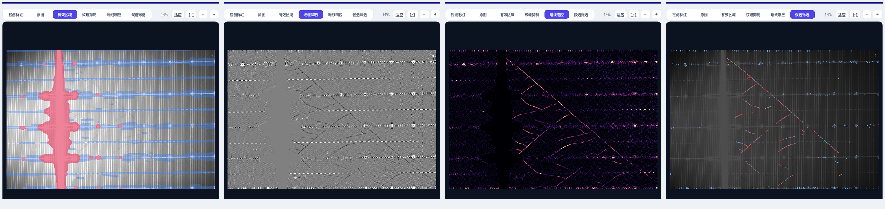

# 太阳能电池板内部缺陷（隐裂）检测 —— 设计报告

> 课程：数字图像处理 大作业　｜　实现语言：MATLAB（Image Processing Toolbox）　｜　难度系数 0.97

## 1 题目与检测目标

题目要求使用 10–20 张有缺陷样本和若干无缺陷样本，逐张判断电池片是否有缺陷，并标出缺陷位置。
结合题图与两批实拍图，本设计把**电池片内部的可见隐裂**作为检测目标：隐裂在图中表现为一条宽约 4–8 像素、
比两侧略暗（约暗 3%–10%）的细线，常斜向跨越大量细栅线，可以是单条长裂纹，也可以是相交、弯曲的网状裂纹。

需要排除的正常结构包括：等间距的亮细栅线及其边缘残影、细栅之间的点划状暗纹、交错排列的断栅短横线、
带焊点的汇流条及其两侧暗色焊带、电池片之间的亮缝和切角、大面积过曝区、孤立亮点/暗斑和亮色划痕。

整体方案为**小样本可复现的传统图像处理**：不训练模型，所有阈值集中在 `src/crack_config.m`，
长度类参数以每张图实测的细栅间距（pitch）为单位，同一套参数处理全部图像。

## 2 样本与参考标签

### 2.1 样本清点

| 项目 | 情况 |
| --- | --- |
| 原图数量与格式 | 20 张 JPG，均为 5488×3672，彩色（实际为灰度内容），JPEG 质量约 80 |
| 与题述 2048×1370 的关系 | 5488/2048 ≈ 3672/1370 ≈ 2.68，仓库中的图是原尺寸的 2.68 倍版本；题述“相邻细栅间距约 21–24 像素”对应本图约 56–64 像素。程序从像素估计栅距（本批实测 47.5–63.6 px），不依赖固定尺度 |
| 存放位置 | `cracked/cracked_01..10.jpg`（第一批）、`uncracked/uncracked_01..10.jpg`（第二批），保留原文件名，程序只读 |
| 题目截图 | `{3227C4FD-…}.png` 不在仓库中；扫描函数仍按 `{GUID}.png`、`preview`、`_overlay`、`_mask`、`outputs/` 等规则排除截图、预览图和程序输出 |

仓库中的文件已被重命名为序号，原始文件名中的拍摄时间不再可见，图像也没有 EXIF。
按“文件序号与任务表中时间顺序一致”推断对应关系，并用任务描述中的 4 个可见特征核对，全部吻合：

| 文件 | 推断时间 | 核对依据 |
| --- | --- | --- |
| cracked_01 | 20220726-083504 | 唯一一张细栅接近水平的图 |
| cracked_07 | 20220728-201710 | 亮缝右侧一条向右下、跨过多根细栅的长暗纹 |
| cracked_09 | 20220728-212250 | 亮缝右侧多条相交、弯曲的暗纹 |
| uncracked_07 | 20220906-202442 | 明显交叉亮缝和大面积高亮 |

`data/labels.csv` 记录每张图的文件名、推断时间、批次、标签、标签来源、复核状态、拍摄组和样本条件标签。
拍摄组按日期和时段划分：G1（0726 上午，1 张）、G2（0726 晚，2 张）、G3（0727 晚，3 张）、G4（0728 晚，3 张）、
G5（0905，1 张）、G6（0906，10 张无隐裂图，在约 2 分钟内连续拍摄）。

### 2.2 参考标注

- **类别标签**：第二批 10 张沿用提供的“无隐裂”标签，并目视浏览确认没有长暗纹；第一批 10 张逐张在原图和对比度拉伸视图上核实，**10 张都能看到明确的暗色裂纹**，不缺有隐裂样本。
- **位置标注**（`data/annotations.json`）：对第一批每张图画 1–5 条主要裂纹的参考折线（共 29 条）和一个包住全部可见裂纹的紧凑区域框。“放大核对”的折线在 0.4 倍以上局部视图描点，“概略”的折线在 0.27–0.33 倍总览图描点；用叠加检查估计**标注精度约 ±50 px**（约 1 个栅距）。网状裂纹（cracked_02/03/09 等）的细小分支没有逐条描线。
- 标注在编写检测程序之前完成，之后没有根据检测结果修改；检测函数只接收图像和参数，参考标签仅在评估阶段由 `evaluate_results.m` 读取。

## 3 总体流程

```
原图 I ──► 灰度 (double, [0,1])
   │
   ├─► 缩略图（长边 1200）：Hough 线段长度加权定主方向 ─► 3×3 分块投影自相关 ─► 细栅方向 θ、栅距 p
   │
   └─► 工作图（缩放 s = 28/p，本批约 0.5）─► 按 θ 旋转使细栅竖直（对齐坐标系）
          │
          ├─ 有效区域：宽亮带/大亮区（亮缝、过曝）外扩 0.8p 排除，小亮斑外扩 0.25p，图像边界留 0.5p
          ├─ 背景 B：有效像素上的带掩膜高斯平滑（σ = 1.5p）
          │
          ├─ 基线：D = max(B − I, 0) ─► 中位数 + 3·MAD 阈值 ─► 面积/主轴长度筛选
          │
          └─ 改进法：
               相对残差 (I − B)/B
               ─► 沿细栅方向分块中值（2.5p）减去：去细栅与其竖向纹理
               ─► 沿主栅方向分块中值（4p）减去：去汇流条、断栅行等横向重复结构
               ─► 12 方向 × 3 个法向偏移的暗线响应 max(0, min(左, 右) − 中心)
               ─► 分块稳健 z 分数；z 沿两个栅线方向的 0.7 分位数再减去（重复结构降权）
               ─► 双阈值滞后（种子在响应脊线上 z ≥ 4.5，生长 z ≥ 2.5）
               ─► 细化骨架 ─► 同片内共线断点连接 ─► 长度/跨栅数/方向/宽度/汇流条占比筛选
               ─► 分支生长 ─► 判定（有隐裂 / 无隐裂 / 待复核）
          │
          └─► 骨架反旋转、反缩放回原图 ─► 原图上沿法向 ±3 px 吸附到暗线中心 ─► 中心线、掩膜、边界框
```

## 4 各步骤设计

### 4.1 灰度与有效区域（`read_gray.m`、`prepare_image.m`）

彩色图按 0.2989R + 0.5870G + 0.1140B 转灰度并保持浮点；灰度、索引色、带 alpha 和 16 位图都能读取。
在对齐后的工作图上：

1. 用 σ = 0.25p 平滑（压掉细栅），灰度 > 0.90 的像素作为亮区候选，再用半径 0.45p 的圆盘开运算去掉细栅，只保留宽亮带和大亮斑；
2. 面积 > 4p² 的亮区视为**亮缝或过曝区**，向外排除 0.8p，避开电池片边缘的暗边和切角斜边；较小的亮区（焊点、反光）只外扩 0.25p；
3. 图像边界向内 0.5p 和旋转后越界部分无效；剩余区域按 4 连通标记为“片”（`cells`），供断点连接判断“同片”。

亮缝/过曝区占比超过 25% 时在结果备注中写明“该区域不参与检测”；有效区不足 30% 时判为**待复核**。
第二批无隐裂图右侧大面积过曝，被排除的亮区占 26%–42%，有效区为 51%–75%。

### 4.2 栅线方向与间距（`estimate_grid.m`）

在长边 1200 像素的缩略图上进行：

1. 亮细线图 = 轻平滑图 − σ=3 的平滑图，取正值、排除饱和区，取前 12% 作二值图；
2. `hough` / `houghpeaks` / `houghlines` 求线段，把线段**按长度加权**统计方向直方图（循环平滑），取前两个主方向作候选（细栅方向及与之垂直的主栅方向）；
3. 对每个候选方向，用 Hessian 计算“垂直于该方向的二阶导” max(0, −D_uu) 作为投影权重——它只对沿该方向的亮细线有响应，断栅短横线、汇流条等横向结构的权重接近 0；
4. 把图像分为 3×3 块，每块在 ±1.5° 内搜索使投影最尖锐的角度，再对该块投影做自相关，取第一个达到最高峰 50% 的峰作为栅距（抛物线插值到亚像素）；
5. 各块角度与栅距取中位数；以各块自相关峰值的中位数作为周期性指标，选周期性更强的候选作为细栅方向。周期性 < 0.12 时视为估计失败，回退为不旋转、默认栅距，只做局部暗纹检测，并写入复核原因。

实测得到的细栅方向：cracked_01 为 0°（近水平），其余 80.9°–90°（竖直或倾斜 3°–9°）；栅距 47.5–63.6 px；
周期性指标 0.54–0.73。分块角度最多相差 3.7°，说明镜头畸变/透视使栅线方向在图内渐变，这是采用分块估计的原因。

### 4.3 对齐与背景

工作缩放比 s = 28 / p（本批约 0.44–0.59），缩小前用 σ = 0.45/s 的高斯抗混叠，用可分离的稀疏重采样矩阵实现
（`resample_matrix.m`，坐标约定 x_原 = (x_工作 − 0.5)/s + 0.5）。再按 θ 旋转到“细栅竖直”的对齐坐标系
（`make_geometry.m` / `to_aligned.m`，显式坐标变换 + `interp2`，正反变换严格互逆）。

背景 B 只用有效像素估计：B = G_σ * (I·V) / G_σ * V，σ = 1.5p，避免亮缝抬高邻近背景。
后续使用相对残差 (I − B)/B，使左右明显不同的亮度（本批左暗右亮）下裂纹对比度可比。

### 4.4 基线（`detect_baseline.m`）

与改进法共用有效区、背景、工作尺度和原图映射。对 D = max(B − I, 0) 在有效区内取
阈值 T = 中位数 + 3 × 1.4826 × MAD，二值化后去掉小于 0.3p² 的连通域，保留主轴长度 ≥ 2p 的连通域作为裂纹，
有任一保留连通域即判为有隐裂。

实际运行发现：细栅之间的整片区域都比 B 暗，D 在有效区内处处为正，稳健阈值因此被抬高，
真正被阈值选出的是更暗的结构——**图像边缘和片边暗区、汇流条焊带、过曝过渡区的暗边**，而淡裂纹本身反而达不到阈值
（例如 cracked_07 中基线“检出”的两处都在左上角图像边缘，见 `outputs/baseline/debug/cracked_07/`）。

### 4.5 栅线与横向结构抑制（`crack_response.m`、`block_profile.m`）

对齐坐标系中细栅竖直。把相对残差按行分成高 2.5p 的块（50% 重叠），每块**逐列求忽略无效像素的中位数**，
得到“垂直于细栅方向的一维重复纹理”，块间沿行方向线性插值后减去。这一步去掉细栅亮线、细栅间的点划状暗纹等竖向周期结构；
斜向裂纹在一列中只占少数像素，不影响中位数。块长取 2.5p 而不是更长，是为了跟随因畸变引起的栅线方向缓慢变化。

再按列分成宽 4p 的块逐行求中位数并减去，去掉汇流条、断栅行等横向重复结构；
同时把横向剖面 |Q| 超过 3.5 倍稳健标准差的行（向上下扩 0.35p）标为**汇流条带**，供后续降权。
这种“减去稳健估计”的方式保留了栅线交点处的真实暗纹，没有对整行整列做硬掩膜。

### 4.6 细暗线增强（`dark_line_response.m`）

对 12 个方向 θ（间隔 15°）：先沿 θ 方向在长约 1p 的线段上做带掩膜均值（隔点取样），
再沿法向两侧各偏移 d 取样，响应为

  r_θ,d = max(0, min(S(p + d·n), S(p − d·n)) − S(p))，　d ∈ {0.08p, 0.13p, 0.20p}（原图约 4 / 7 / 11 px）

取所有方向、偏移中的最大值及其方向。“中心比两侧都暗”才有响应，亮细栅旁的台阶边缘、亮点周围的一侧暗边响应接近 0；
多尺度偏移兼顾 4–8 像素宽的细裂纹和较宽的裂纹。

### 4.7 归一化与重复结构降权

把栅线抑制后的残差分成 6p×6p 的块，计算每块的稳健标准差（1.4826·MAD，下限为各块中位数的一半），
插值成整幅图后得到 z = r / σ_局部。实测无隐裂图中 z 的 99.9 分位数约 3.4–4.5，裂纹上的 z 约 3–10，
单像素阈值无法区分，必须依靠连续长度。

残留的栅线边缘、断栅行和汇流条焊点仍会在整行或整列上连续产生响应。因此对 z 再沿细栅方向（2.5p 块）
和主栅方向（4p 块）分别求 **0.7 分位数**并减去：局部裂纹只占块内少数像素，不改变高分位数；
重复结构则被成片减掉。只有与水平夹角 ≤ 10° 的长裂纹在同一行内占比较大时才会被削弱。

### 4.8 分割、连接与筛选（`segment_cracks.m`、`link_segments.m`）

1. **双阈值**：生长区为 z ≥ 2.5 的有效像素（汇流条带内去掉与主栅平行的响应）；种子必须是沿法向的响应脊线（非极大值抑制）且 z ≥ 4.5；用 `imreconstruct` 保留含种子的连通区。
2. **骨架化**：`bwmorph(…,'thin',Inf)`，去掉短于 0.4p 的碎段。
3. **断点连接**：只连接同一片内、属于不同骨架段的端点；端点方向取端点相对其附近骨架均值的外延方向。距离 ≤ 1.5p 时两端方向与连线夹角 ≤ 35°；方向高度一致（≤ 15°）时允许 ≤ 3.5p，用于连接被汇流条和焊点隔开的同一条裂纹；两段平均响应相差不超过 4 倍；按距离贪心匹配，每个端点只连一次。
4. **形状筛选**（每个连通骨架段）：
   - 平均宽度 ≤ 0.3p（排除斑块）、骨架平均 z ≥ 3.0、骨架长度 ≥ 3p；
   - 斜向段须横跨 ≥ 2 根细栅（优先保留跨越多根细栅的非周期暗线）；
   - 与细栅夹角 ≤ 15° 的段须长 ≥ 8p，与主栅夹角 ≤ 15° 的段须长 ≥ 5p（近似平行栅线的真实裂纹仍可保留，但要更长）；
   - 骨架落在汇流条带内的比例 ≤ 0.5（排除焊点周围的 X 形暗纹、焊带暗边）。
5. **分支生长**：图中已有确认裂纹时，再用较低种子阈值（z ≥ 3.5）取一套候选，与已确认裂纹相距 ≤ 2p、长度 ≥ 1p、形态合格的段迭代并入最近的裂纹（最多 3 轮），用于保留分叉和较弱的延伸段。生长只在已判定有裂纹时进行，不影响无隐裂图的判定。
6. 每个最终连通段编号为一条裂纹（按长度降序）。

### 4.9 判定与复核原因

- 有 ≥ 1 条确认裂纹 → **有隐裂**；
- 没有确认裂纹，但有效区不足或栅线估计失败 → **待复核**（写明原因）；
- 没有确认裂纹，但有长度、跨栅数达到阈值 60% 的弱候选 → **待复核**；
- 否则 → **无隐裂**。读取或处理出错时记为读取失败/处理失败并写明错误，批处理继续。

### 4.10 原图定位（`skeleton_to_full.m`）

骨架像素 (u, v) 先由对齐坐标反旋转到工作图，再按 x_原 = (x_工作 − 0.5)/s + 0.5 映射回原图。
由于工作图约为原图的一半，每个点再在**原图上**沿局部法向 ±3 px 搜索最暗处（沿裂纹方向 3 点平均），
偏移量在骨架邻域内平滑以免锯齿；相邻骨架像素在原图上连线得到中心线，按估计宽度膨胀得到原尺寸掩膜。
每条裂纹输出边界框、质心、长度、平均宽度、方向、端点和中心线采样点。坐标约定：左上角像素为 (1,1)，
x 为列、y 为行，边界框 [x_min, y_min, x_max, y_max] 含两端。

## 5 调试中发现的问题与对应修改

| 实测现象 | 原因 | 修改 |
| --- | --- | --- |
| cracked_04 栅距估成 112 px（约 2 倍） | 整幅投影被畸变造成的角度渐变抹平，断栅短横线交错排列形成 2 倍周期 | 改为 3×3 分块估计；投影权重改为垂直于细栅方向的二阶导 |
| cracked_02/03/05 栅距估成 27 px、θ 恰为 90° | θ 为 0°/90° 时投影坐标全是整数，0.5 px 分箱隔一个空一个，空箱置零造成假周期 | 1 px 线性软分箱，空箱插值 |
| 单张 80–110 s | `repmat` 生成平移底图、大数组 double 累加、`interp2` 缩放 | 预分配平移、single 精度、隔点取样、可分离稀疏重采样；检测本身降至约 30–40 s（Octave），含导出约 42–108 s |
| z 图中断栅行、汇流条行呈点划状强响应，细碎纹理连成大片 | 交错结构不连续，行中值不能完全去掉；低阈值下纹理相互连通 | 对 z 沿两个方向减 0.7 分位数；改用“脊线种子 + 连通生长” |
| cracked_07 裂纹下半段 z 只有 2.5–4.5，被截断 | 下半段裂纹较淡 | 生长阈值降到 2.5、种子 4.5，依靠长度与跨栅数区分纹理 |
| uncracked_03 / uncracked_10 各有一条长 3.7p 的“裂纹” | 完全落在汇流条带内（焊点附近的斜向暗纹） | 增加“汇流条带内占比 ≤ 0.5”条件 |
| cracked_07 的裂纹在每条汇流条处断开 | 汇流条带内平行响应被去掉，间隔约 3.4p，超过连接距离 | 增加方向一致（≤15°）时 ≤ 3.5p 的共线连接 |
| 长度统计偏大数倍 | 吸附后的点锯齿化 | 长度按骨架像素数对角修正计算；吸附偏移沿骨架平滑 |
| 评估读 CSV 列错位 | `strsplit` 默认合并连续逗号，空字段消失 | 改用 `regexp(…,'split')` |

## 6 实验结果

### 6.1 运行条件

| 项目 | 内容 |
| --- | --- |
| 实测环境 | GNU Octave 8.4.0 + image 包 2.14.0（Ubuntu 24.04，x86_64，单线程运行）。开发环境中**没有 MATLAB**，MATLAB 下的实测结果尚待生成；代码只用 MATLAB 基础函数和 Image Processing Toolbox 函数，并避开 Octave 专有语法 |
| 命令 | 项目目录下 `octave --no-gui --eval "run_demo"`（MATLAB 为 `matlab -batch "run_demo"`） |
| 输入 | `cracked/`（10 张）与 `uncracked/`（10 张），共 20 张，没有读取失败 |
| 设置 | `src/crack_config.m` 默认参数，基线与改进法使用同一配置；完整参数见 `outputs/run_config.json` |
| 耗时 | 全流程 29.7 分钟；改进法每张 42–108 s（含原尺寸标注图与中间结果导出），基线每张 15–53 s |
| 记录 | `outputs/run_demo_log.txt`、`outputs/run_log.txt`、`outputs/baseline/run_log.txt` |

### 6.2 有无隐裂的判定

指标分母为已判定的图像（两种方法都没有待复核和错误，因此两种口径相同）。

| 方法 | TP | FP | TN | FN | 待复核 | 准确率 | 查准率 | 召回率 | F1 | 无隐裂样本误报 |
| --- | --- | --- | --- | --- | --- | --- | --- | --- | --- | --- |
| 基线 | 5 | 1 | 9 | 5 | 0 | 70.0% | 83.3% | 50.0% | 62.5% | 1 / 10 |
| **改进法** | **10** | **0** | **10** | **0** | 0 | **100%** | **100%** | **100%** | **100%** | **0 / 10** |

基线逐张的误报、漏报原因：

| 图像 | 基线结果 | 原因 |
| --- | --- | --- |
| cracked_02、05、06、09、10 | 漏报 | 细栅间隙在 D = max(B − I, 0) 中处处为正，稳健阈值被抬高，淡裂纹（比两侧暗 5%–9%）达不到阈值 |
| cracked_01、03、04、07、08 | “判对”但位置错误 | 选出的是图像边缘/片边暗区（如 cracked_01 左边缘、cracked_07 左上角）和亮划痕旁的暗边，没有一处落在参考裂纹上（见 6.3） |
| uncracked_04 | 误报 | 汇流条旁一段暗色焊带（x≈3193–3290，y≈296–329） |

也就是说，基线即使判对，也只是碰巧在有裂纹的图里选中了其他暗结构，不能作为可用的定位方法。

### 6.3 位置评价

容差取 50 px（约 1 个栅距，对应人工标注精度），同时列出 25 px 的结果。“参考覆盖率”是参考折线采样点中距预测掩膜 ≤ 容差的比例；
“预测精度”是预测掩膜像素中距参考折线 ≤ 容差的比例；“区域内比例”把落在参考区域框内的预测也计为位置正确。
合计按点/像素汇总，逐张数据见 `outputs/evaluation/evaluation.md`。

| 方法 | 参考覆盖率@25 | 预测精度@25 | 参考覆盖率@50 | 预测精度@50 | 区域内比例@50 |
| --- | --- | --- | --- | --- | --- |
| 基线 | 0.0% | 0.0% | 0.1% | 0.2% | 2.0% |
| **改进法** | 24.3% | 34.2% | **36.8%** | **52.3%** | **99.2%** |

| 改进法逐张 | 检出裂纹数 | 参考覆盖率@50 | 预测精度@50 | 区域内比例@50 |
| --- | --- | --- | --- | --- |
| cracked_01（细栅水平） | 2 | 33.4% | 100.0% | 100.0% |
| cracked_02（网状） | 3 | 39.9% | 98.9% | 100.0% |
| cracked_03（网状、很淡） | 2 | 19.0% | 75.1% | 100.0% |
| cracked_04（倾斜 7°） | 6 | 50.2% | 57.0% | 100.0% |
| cracked_05 | 6 | 36.8% | 50.5% | 100.0% |
| cracked_06 | 1 | 0.0% | 0.0% | 100.0% |
| cracked_07（单条） | 2 | 49.7% | 72.6% | 100.0% |
| cracked_08 | 1 | 48.0% | 98.5% | 100.0% |
| cracked_09（多条相交） | 14 | 53.9% | 26.6% | 98.1% |
| cracked_10（交叉亮缝） | 3 | 48.4% | 80.3% | 100.0% |

解读：

- **检出的位置是可靠的**：99.2% 的预测像素落在参考裂纹区域内；用脚本在原图上核对，40 条检出裂纹的中心线都比两侧 ±10 px 暗（中位数约暗 10 个灰度级），包括需要旋转 90° 的 cracked_01，说明旋转、缩放后的坐标映射正确。
- **对裂纹全长的覆盖不完整**：按 50 px 容差约覆盖参考折线的 37%。未覆盖的主要是很淡的段、汇流条和断栅行附近被降权的段、亮缝两侧被排除的段（如 cracked_01 左侧裂纹穿过饱和亮带）。
- 预测精度偏低的几张（cracked_09、05、04）多为检出了参考中没有逐条描线的网状分支，它们仍在区域框内；cracked_06 的检出在一条未描线的平行斜裂纹上，覆盖率和精度均为 0 但区域内比例为 100%。
- 25 px 与 50 px 容差的差别主要来自人工折线本身的误差：例如 cracked_10 的预测精度在 25 px 下只有 11%，在 50 px 下为 80%，红线实际贴着暗纹，偏差来自概略描点。

### 6.4 代表样本的中间结果

每个样本按处理顺序给出 01 原图、02 有效区域（红色为排除区，蓝色为汇流条/横向结构带）、03 亮度校正残差、
04 栅线抑制后残差、05 暗线响应 z、06 筛选前候选（蓝 = 未入选，橙 = 弱候选，红 = 最终裂纹，绿 = 断点连接）、07 最终叠加图。

| 样本 | 条件 | 路径 |
| --- | --- | --- |
| cracked_07 | 单条长裂纹，亮缝右侧 | `outputs/debug/cracked_07/` |
| cracked_09 | 多条相交、弯曲裂纹 | `outputs/debug/cracked_09/` |
| cracked_01 | 细栅近水平（θ = 0°），竖向宽亮带饱和 | `outputs/debug/cracked_01/` |
| cracked_04 | 细栅倾斜约 7°，有亮划痕 | `outputs/debug/cracked_04/` |
| uncracked_07 | 交叉亮缝、大面积高亮的无隐裂图 | `outputs/debug/uncracked_07/` |


从中间结果可以看到：03 中细栅仍是主要纹理；04 中细栅、断栅行基本被消去，裂纹成为最明显的暗线，残留的是汇流条焊点和少量栅线边缘；
05 中裂纹是连续的亮线，背景为细碎的弱响应；06 中蓝色的未入选候选集中在汇流条行和焊点附近，被“汇流条带占比”和长度条件排除。
基线的对应中间结果在 `outputs/baseline/debug/`，其 03 图显示 D = max(B − I, 0) 在所有细栅间隙中都很高。

### 6.5 对不同样本的适用性

同一套固定参数下按样本条件统计（一张图可属于多个条件）：

| 条件 | 张数 | 改进法正确 | 基线正确 | 说明 |
| --- | --- | --- | --- | --- |
| 细栅近水平 | 1 | 1 | 1（位置错误） | cracked_01 自动估计 θ = 0°，旋转后同样处理；右侧裂纹两段被检出，左侧裂纹穿过饱和亮带的部分未检出 |
| 细栅近竖直（≤3°） | 7 | 7 | 3 | |
| 细栅倾斜（3°–9°） | 12 | 12 | 10 | 含 10 张无隐裂图；分块角度差最多 3.7° |
| 单条裂纹 | 1 | 1 | 1（位置错误） | cracked_07 主裂纹从亮缝旁连续标到第三条汇流条（中间跨过一条汇流条靠共线连接），在汇流条处分为 #1、#2 两段；最下方的淡尾段未检出 |
| 多条 / 网状裂纹 | 9 | 9 | 4 | cracked_09 保留 14 条，包括弯曲和相交的裂纹 |
| 亮缝 / 交叉亮缝 | 17 | 17 | 12 | 亮缝外扩 0.8p 排除，片边暗边和切角不再产生响应 |
| 大面积过曝（无隐裂组） | 10 | 10 | 9 | 26%–42% 的面积被排除，结果备注中写明 |
| 暗斑（无隐裂组） | 2 | 2 | 1 | 斑块宽度超过 0.3p 或长度不足，被排除 |
| 亮划痕 | 3 | 3 | 2 | 划痕本身是亮线，不产生暗线响应；划痕旁的暗边较短，未形成误报 |

导致漏检或覆盖不全的困难区域：亮缝和过曝区（直接排除，裂纹在其中不可见也不可检）、汇流条带（为抑制焊带误报而降权，裂纹在此断开，依靠共线连接补回）、
极淡的网状分支（cracked_03 只检出 2 段）。导致误报风险的正常结构：汇流条焊点附近的 X 形暗纹（去掉“汇流条带占比”条件后出现 2 个误报，见 6.6）、
栅线边缘残影和断栅行（通过分位数降权消除）。

### 6.6 参数敏感性

用 `tools/param_sensitivity.m` 对每个关键参数单独上下浮动（其余保持默认），统计 20 张图的判定（`outputs/evaluation/param_sensitivity.md`）：

| 参数设置 | TP | FN | TN | FP | 待复核 | 判定改变的图像 |
| --- | --- | --- | --- | --- | --- | --- |
| 默认参数 | 10 | 0 | 10 | 0 | 0 | |
| zHigh = 4.0 / 5.0 | 10 | 0 | 10 | 0 | 0 | |
| zHigh = 5.5 | 9 | 0 | 10 | 0 | 1 | cracked_06 变为待复核 |
| zLow = 2.0 / 3.0 | 10 | 0 | 10 | 0 | 0 | |
| minLength = 2.5 / 4.0 | 10 | 0 | 10 | 0 | 0 | |
| minCross = 1.5 / 3.0 | 10 | 0 | 10 | 0 | 0 | |
| minMeanZ = 2.5 / 3.5 | 10 | 0 | 10 | 0 | 0 | |
| 不做长距离共线连接 | 10 | 0 | 10 | 0 | 0 | |
| 不排除汇流条带候选 | 10 | 0 | 6 | 2 | 2 | uncracked_03、05 误报，uncracked_04、10 待复核 |

判定对多数阈值的小幅变化不敏感；起关键作用的是“汇流条带内占比”这一结构性条件。
调参过程中曾观察到个别无隐裂图在阈值附近变为“待复核”，说明无隐裂组中汇流条附近的候选与阈值之间的余量并不大。

## 7 图形界面小程序

为了便于演示和逐张查看，另做了图形界面 `crack_app.m`。在 MATLAB 命令窗口输入 `crack_app` 打开；
`crack_app('demo')` 会直接载入项目中的 20 张示例图和 `outputs/` 中已有的检测结果。


- **输入**：添加单张或多张图片、整个文件夹，有隐裂和无隐裂样本可以混合输入；也可以载入任意输出目录中的 `defects.json`。
- **检测**：调用与批处理相同的 `detect_cracks` / `detect_baseline`，可切换改进法与基线；逐张处理并显示进度和预计剩余时间，可中途停止，单张出错不影响其余图片。
- **显示**：左栏是带缩略图和判定标签的图片列表与检测概览；中间的查看器在原图坐标系中显示，支持滚轮缩放、拖动平移，放大后从原图裁取高清细节，并实时显示鼠标处的原图坐标与灰度；右栏给出判定、裂纹数与总长、细栅方向与间距、有效区域与亮缝 / 过曝占比、复核原因，以及每条裂纹的长度、角度、宽度、对比度、跨越细栅数和外接框，点击即定位。
- **中间结果**：在界面中检测的图片可切换“有效区域、纹理抑制、暗线响应、候选筛选”四个视图，对应第 4 节的处理步骤（下图从左到右）。



- **导出**：写出与 `run_batch` 相同格式的 `results.csv`、`defects.json`、原尺寸标注图和掩膜。
- **参考标签**：若存在 `data/labels.csv`，界面显示每张图的参考标签和整体一致率，仅作对照，不参与检测。

界面用 `figure`、`uicontrol` 和坐标区绘图实现，不依赖 App Designer，MATLAB 与 Octave 共用同一份代码。
本次在 GNU Octave 8.4 下实际运行，并用模拟鼠标、键盘操作验证了添加、检测、停止、切换视图、缩放平移、点选裂纹和导出等功能；
在界面中检测 cracked_07、cracked_09、uncracked_07 的结果与批处理一致。界面在 MATLAB 中的显示效果尚未实测。

## 8 局限与改进方向

1. **样本与泛化**：全部 20 张图都参与了调参，第 6 节的指标描述的是本批样本上的表现，不是对新组件的独立测试。无隐裂组 10 张在约 2 分钟内对同一组件连续拍摄（G6），彼此高度相关，相当于“一个组件的多次拍摄”；有隐裂组来自 5 个拍摄时段。曾考虑按拍摄组留出测试，但无隐裂样本只有 G6 一组，留出后无法同时评估误报，因此没有做组间留出。新组件或新相机下应先用若干张无隐裂图检查误报，再决定是否调整 `zHigh`、`minLength`。
2. **样本来源**：仓库中的文件被重命名，拍摄时间是按序号推断的（4 个特征点吻合）；图像为原始 2048×1370 的 2.68 倍放大版本，有效分辨率低于像素尺寸。
3. **参考标注精度**：折线由人工在缩略图和局部图上描点，精度约 ±50 px，网状裂纹只描了主干，因此位置指标只能作为粗略参考；预测精度被低估、覆盖率的分母也不完整。
4. **覆盖不全**：亮缝、过曝区直接排除；汇流条带内对平行响应降权；很淡的段（相对暗度 < 3%）达不到阈值。可改进的方向：沿已检出裂纹方向做跟踪式延伸、对汇流条带改用局部方向一致性判断而不是整带降权、在过曝区改用局部对比度归一化检测残留纹理。
5. **栅线对齐**：采用一次刚性旋转，图内栅线方向约有 3° 的渐变，靠较短的中值分块和 z 分位数降权吸收残影；可改为按分块角度做非刚性对齐。
6. **运行平台**：结果在 GNU Octave 上实测；MATLAB 下数值应基本一致（`hough`、`imresize` 等未参与关键计算的实现差异除外），但仍需在 MATLAB 中运行 `run_demo` 确认。

## 9 提交文件

| 内容 | 位置 |
| --- | --- |
| 程序源代码 | `run_demo.m`、`run_batch.m`、`crack_app.m`（图形界面）、`src/*.m`、`tools/param_sensitivity.m` |
| 说明 | `README.md`（版本、结构、命令、参数、坐标规则、界面说明）、本报告、`docs/images/` 界面截图 |
| 参考标签与标注 | `data/labels.csv`、`data/annotations.json` |
| 改进法结果 | `outputs/results.csv`、`outputs/defects.json`、`outputs/overlays/`、`outputs/masks/`、`outputs/debug/` |
| 基线结果 | `outputs/baseline/`（同结构） |
| 评估 | `outputs/evaluation/evaluation.md`、`evaluation_per_image.csv`、`evaluation.json`、`param_sensitivity.md` |
| 运行记录 | `outputs/run_demo_log.txt`、`outputs/run_log.txt`、`outputs/run_config.json` 及基线对应文件 |

